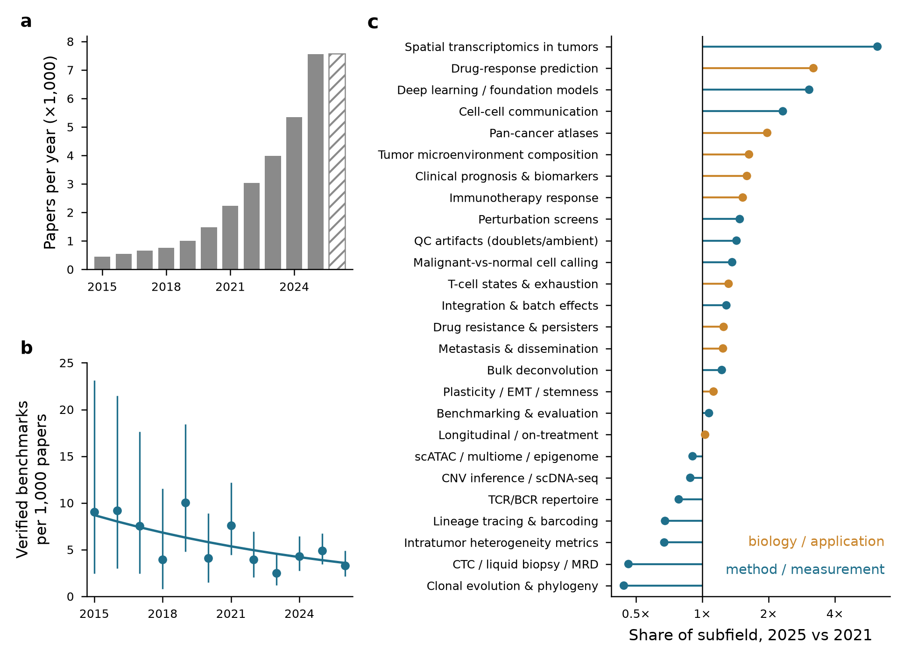
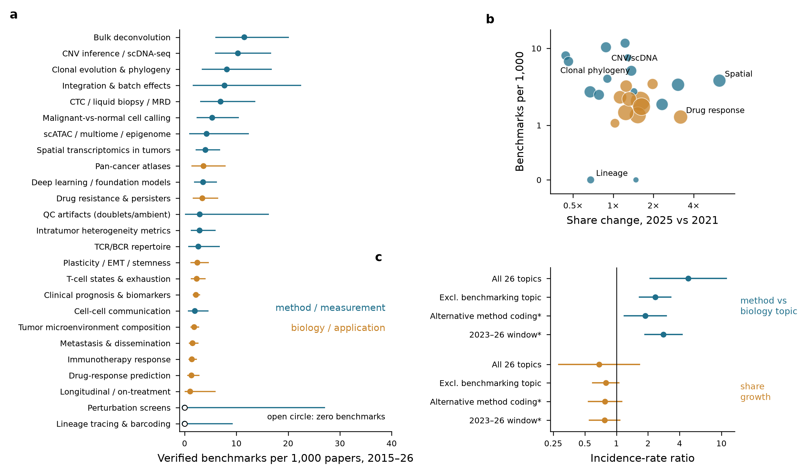
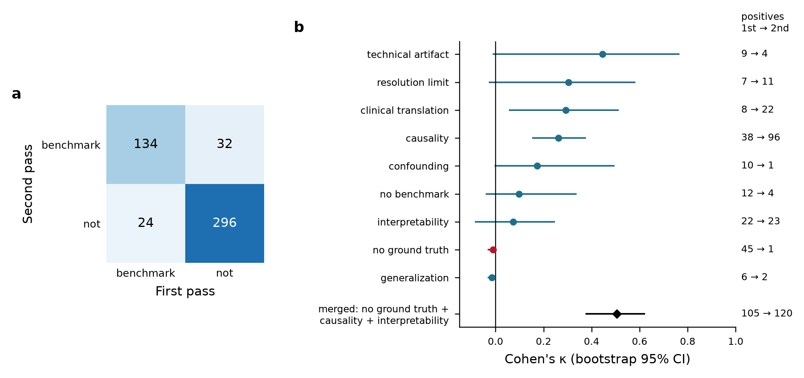
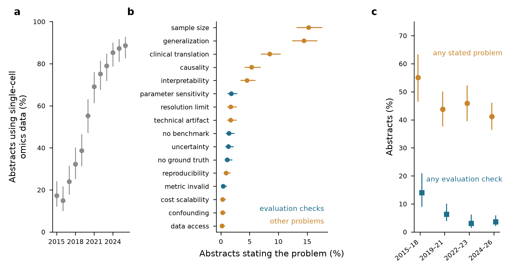
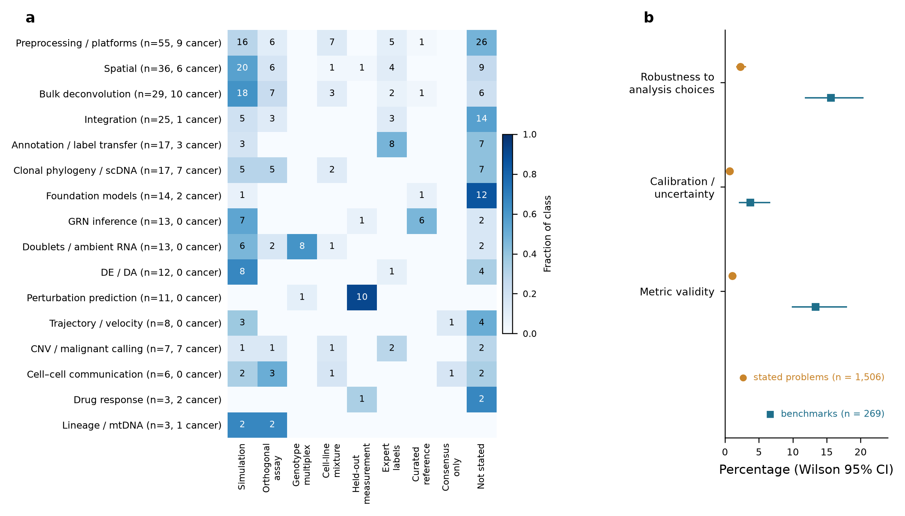
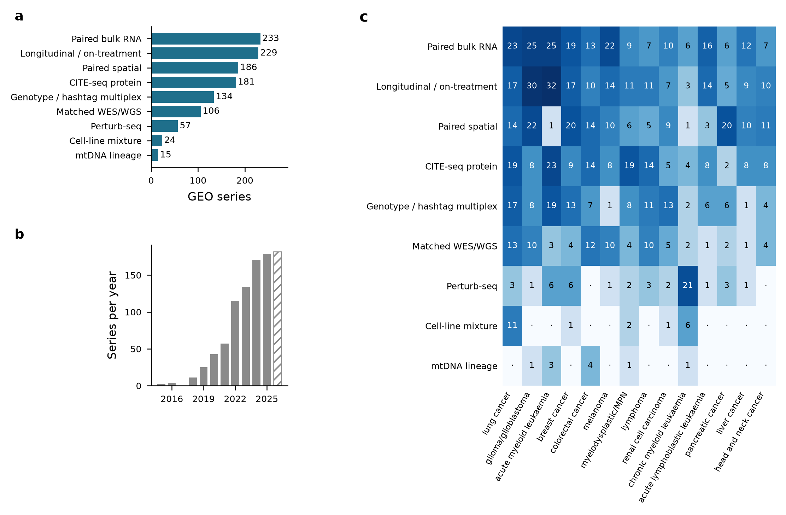

## Abstract

**Background.** Single-cell cancer genomics grew from 443 PubMed records in 2015 to 7,556 in 2025. Whether evaluation of its computational methods has kept pace has not been quantified.

**Methods.** We combined a 26-topic PubMed volume series (2015 to 15 October 2026); verification of all 489 evaluation-titled papers with a second, model-based coding pass; a catalogue of 269 PubMed-verified benchmarks in 16 method classes, coded for ground-truth strategy and for assessment of robustness, calibration and metric validity; a catalogue of 923 GEO tumour single-cell series carrying orthogonal validation data; and explicit-definition coding of a stratified sample of 1,771 unique abstracts (150 draws per year, 2015–2026). Rates were modelled by negative-binomial and Poisson regression with topic-clustered robust standard errors.

**Results.** Of 489 evaluation-titled papers, 158 (32.3%; 95% CI 28.3–36.6) were genuine benchmarks (inter-pass κ = 0.74). Benchmarks per 1,000 papers declined by 7.8% per year (rate ratio 0.922, 0.875–0.972). Coverage in method and measurement topics was flat under every variance estimator (1.012, 0.927–1.103), and the decline in biology and application topics (0.901) was consistent in direction but not robustly established, losing significance under topic-clustered standard errors (0.807–1.006, p = 0.064). Over 2015–2026, method topics received more benchmarks per paper (IRR 2.35, 1.66–3.31; 1.80–2.30 across topic-overlap sensitivity analyses). "No ground truth", the most frequently coded limitation (24.2%), did not replicate on re-coding (κ ≈ 0) and was stated in 1.1% of abstracts under an explicit definition. Abstracts stating any evaluation-check problem fell from 14.0% (2015–18) to 3.6% (2024–26), with no corresponding decline in a non-single-cell control set. Calibration or uncertainty was reported in 3.7% of benchmark abstracts, robustness to analytical choices in 15.6% and metric validity in 13.4% (13.0% excluding one record flagged from its title alone); the 48 cancer-specific benchmarks did not differ from the remainder on any of the three (Fisher p = 1.000, 1.000 and 0.351). This coding was model-assisted under explicit written criteria and hand-read in part, not in full. Public validation data exist on a scale the benchmark literature does not visibly draw on: 106 series carry matched exomes, 181 CITE-seq protein and 186 paired spatial data, these being regular-expression calls with an audited precision of 92.9% and per-modality count ranges given in Table 5.

**Conclusions.** Calibration is the genuinely neglected check in this field, reported in under 4% of benchmark abstracts; robustness and metric validity are reported three to four times more often than a previous version of this analysis found, but still in fewer than one benchmark in six. Substantial public validation data exist for tasks that few benchmarks test. We release both catalogues, a ten-item evaluation standard and an eight-study research agenda.

**Keywords:** single-cell RNA sequencing; cancer genomics; benchmarking; meta-research; ground truth; calibration; multiverse analysis

## 1. Introduction

Biological conclusions drawn from tumour single-cell data depend on a sequence of computational decisions. The identification of malignant cells, the integration of patients, the reference used to label the immune compartment and the inference of cell-type proportions or interactions are each delegated to software. That software typically returns point estimates; in the benchmark literature catalogued here, calibration or uncertainty is assessed in 3.7% of studies (§3.4). Principles for evaluating such software are nevertheless established. Neutral comparison studies [1] should be designed to avoid the self-assessment trap, in which developers rank their own method best [2,3]. They should follow explicit design guidelines [4,5] and be extensible as methods change [6,7]. Landmark neutral benchmarks exist for many single-cell tasks, including clustering [8], differential expression [9,10], trajectory inference [11], annotation [12], batch correction [13,14], doublet detection [15], cell–cell communication [16], spatial integration [17], deconvolution [18] and perturbation prediction [19].

Two questions remain open. The first is whether this evaluation effort has reached cancer-specific applications; tumour microenvironment composition alone accounted for 9,383 papers in 2023–26 (Table 1). The second is whether it addresses the failure modes specific to tumour data. Malignant cells show extensive inter- and intratumoural transcriptional heterogeneity, with 41 recurrent meta-programmes identified across 1,163 tumour samples [20–22]. Copy-number alterations, which are absent from normal tissue, are themselves inferred from expression [20,23,24]. Reference atlases used for annotation are built predominantly from non-malignant tissue [25]. None of these properties is represented in benchmarks that use only non-malignant data. Yet only 48 of the 269 benchmarks catalogued here (17.8%) are cancer-specific (§3.4).

This review quantifies the evaluation gap. We quantify how benchmark coverage has scaled with publication volume across 26 subtopics and test whether coverage is shrinking. We then ask what the literature says is wrong, and check whether those statements survive independent coding. Next we catalogue what existing benchmarks actually check, and locate where ground truth already exists in public repositories. Section 4 synthesises the state of evaluation for each major method class. Section 5 develops the three checks that the evidence identifies as most neglected: metric validity, robustness to analytical choices, and calibration. Section 6 maps the public ground-truth resource. Sections 7 and 8 propose a minimum evaluation standard and a research agenda. The benchmark catalogue, ground-truth catalogue and all derived tables are released with the paper.

## 2. Methods

### 2.1 Taxonomy, volume series and corpus

We defined 26 subtopics of single-cell cancer genomics spanning methods and measurement (for example CNV inference and scDNA-seq, integration, lineage tracing, spatial transcriptomics) and biology and application (for example immunotherapy response, tumour microenvironment composition, metastasis). For each topic and for the subfield as a whole, we retrieved annual PubMed record counts for 2015–2026 through NCBI E-utilities [26], giving 324 topic-year counts. Counts for 2026 run to 15 October 2026 (§2.7). We summarise growth as the ratio of a topic's 2025 share of the subfield to its 2021 share. Abstracts for 2023–2026 (n = 3,627) were harvested with topic tags; topics overlap and are not a partition. A bioRxiv [27] screen (15,682 preprints, 18 months) yielded 372 single-cell cancer preprints. Because the bioRxiv API exposes only a short abstract preview, preprint ratios are not used inferentially here.

### 2.2 Benchmark verification and problem extraction

All 489 papers whose titles contained "benchmark", "comparison", "evaluation" or "assessment" were classified from their abstracts as genuine methods benchmarks or not. The corpus held 486 records at the 4 October 2026 retrieval; three further records were indexed between 5 and 15 October 2026 and none was a methods benchmark (§2.7). A genuine benchmark is a systematic comparison of two or more named tools or platforms on a shared task. Because this title query defines the numerator of every coverage statistic, we measured its recall against the independently assembled benchmark catalogue (§2.5): the query captures 212 of the 267 catalogued benchmarks published in 2015–2026 (79.4%, 74.2–83.8), with no trend across years (logistic odds ratio 1.042 per year, 0.929–1.170, p = 0.48). Coverage estimates are therefore scaled by a recall factor that is incomplete but temporally stable; this estimate is conditional on catalogue membership, since the catalogue was itself assembled partly through title-based queries. Separately, each abstract in the corpus was coded for its stated limitations and open problems into a 17-category controlled vocabulary, giving 1,757 extraction rows. Of these, 1,506 were methodological problems.

### 2.3 Reliability of the coding

Both coding tasks were repeated blind to the first-pass labels, using a reworded prompt and a different model tier. A smaller model (Haiku-tier) rated 394 of the 486 benchmark abstracts. After that model's token budget was exhausted, the remaining 92 benchmark abstracts and the entire random subsample of 200 problem-coded abstracts (seed 1) were rated from condensed abstracts (title, opening and closing sentences) by the coordinating language-model agent that ran the analysis. That agent did not see the first-pass labels, but it is not an independent human coder, and no human adjudication was performed. We report Cohen's κ with bootstrap 95% intervals separately by rater subset. Second-pass counts are from one non-adjudicated pass and are treated as provisional.

### 2.4 Stated problems, 2015–2026

The archived abstract corpus covers 2023–2026 and is weighted towards recent records (2,073 of its 3,627 abstracts were first published in 2026, as confirmed by re-dating every record against PubMed). To examine change over time, we drew a stratified random sample of 150 research abstracts per publication year from 2015 to 2026 (seed 2026) from the subfield query, excluding reviews, editorials, comments and errata and requiring an abstract of at least 400 characters. Each abstract was coded by a model coder (Haiku-class, temperature 0, structured output, 15 abstracts per request) with written definitions for 17 problem types (Table 3); a problem type was coded only when the abstract explicitly stated it, and multiple types per abstract were allowed. The coder also flagged whether the study generated or analysed single-cell omics data, as distinct from flow cytometry, imaging or other non-sequencing single-cell assays. Because PubMed's publication-date field matches both electronic and print years, 29 papers were drawn in two adjacent years; each was counted once, in its earlier year, leaving 1,771 unique abstracts. Analyses were restricted to abstracts flagged as single-cell omics. A random 150 of the coded abstracts were re-coded independently by a stronger model (Sonnet-class) with the same definitions to estimate agreement. The 158 verified benchmarks were flagged for single-cell omics in the same way.

### 2.5 Benchmark catalogue

We assembled a catalogue of benchmark studies relevant to single-cell cancer genomics. Sources were the verified first-pass benchmarks within scope, 16 class-specific PubMed queries, about 90 targeted searches for landmark benchmarks, and 14 supplementary queries. Inclusion required that the primary contribution be a comparative evaluation of at least two existing methods, or of platforms with computational read-outs; preprint and journal versions were merged. All 269 records were resolved through PubMed efetch and re-checked by esummary title match. Evaluation fields are the ground-truth strategy, the number of tools, and whether robustness to analytical choices, calibration or uncertainty, and the validity of the metric itself were assessed. A field is marked as assessed only when the abstract says so. All assessment counts are therefore lower bounds.

An earlier version of this analysis coded these fields by keyword rules with manual correction of 40 records. That procedure proved to have a high false-negative rate, and all 269 abstracts were therefore re-retrieved and re-coded under explicit written criteria, which we state here because the resulting counts differ materially from the keyword coding.

**Robustness to analytical choices** is marked assessed when the abstract names robustness, stability, resilience or reproducibility as one of the dimensions on which the methods were evaluated, compared or ranked. The word "robust" used as a bare quality adjective, a tool name, or reproducibility of the authors' own code does not qualify. We report this narrow criterion because it is the construct the keyword coding attempted to capture. Two broader readings are released with the catalogue as sensitivity analyses: adding abstracts that report varying a named analyst-controlled choice (normalisation, imputation, reference panel, preprocessing, parameters) and its effect gives 79 of 269 (29.4%, 24.2–35.1); adding input-degradation stress tests and dependence on data properties such as sequencing depth, cell number or platform gives 141 of 269 (52.4%, 46.5–58.3). The last of these conflates robustness to analytical choices with robustness to data quality and we do not use it.

**Calibration or uncertainty** is marked assessed when the abstract states that the study examined the reliability of reported probabilities, confidences or error rates: calibration of scores, false-discovery-rate or type-I-error control, false positives on null data, uncertainty quantification, interval coverage, or rejection of out-of-distribution classes judged by the reliability of the prediction. Parameter tuning, instrument calibration, and sensitivity reported only as an accuracy metric at a fixed threshold do not qualify.

**Metric validity** is marked assessed when the abstract states that the study interrogated the scoring function itself: whether a metric measures what it claims, disagreement between metrics or rank changes with the metric, a metric shown to be misleading or inflated, behaviour against null or trivial baselines, or a new metric proposed together with a stated deficiency of existing ones. Using several metrics does not qualify.

Coding was model-assisted under these criteria and then hand-read in part: 132 of the 269 records for robustness and 82 for ground-truth strategy, covering every record whose label changed plus a seeded random sample of the unchanged, with measured agreement between the mechanical pass and hand reading of κ = 0.76 for robustness. Calibration and metric validity were screened for false negatives by keyword over all 269 abstracts, with 3 and 38 flagged negatives then read, rather than by a full hand pass; those two counts may therefore still be slight undercounts. Per-record calls outside the hand-read strata rest on the model-assisted pass and are provisional at the level of the individual record, although the aggregate percentages are stable under the agreement measured above. Three records (PMIDs 41214134, 42637979, 38977827) have no abstract in PubMed; their fields were carried from the earlier coding and are flagged in Supplementary Data S1. One of them (PMID 42637979) carries a metric-validity flag derived from its title in both codings, so the abstract-verifiable metric-validity count is 35 rather than 36 of 269. Per-record evidence spans for every coded field are released in Supplementary Data S1 so that each call can be audited.

### 2.6 Ground-truth catalogue

We queried GEO DataSets [28] for human tumour single-cell series. A base set of 6,141 series was retrieved for orientation but was not classified; the catalogue is assembled only from the union of nine modality queries, which returned 2,715 records. The remaining 3,426 base-set series (56%) were never screened, so a validation-bearing series missed by all nine modality queries cannot enter the catalogue and the counts below are lower bounds on what GEO holds. From series-level text we classified nine validation modalities: matched WES/WGS, CITE-seq protein, genotype or hashtag multiplexing, paired bulk RNA, paired spatial, mtDNA lineage, longitudinal or on-treatment sampling, cell-line mixtures and Perturb-seq. Classification used documented regular-expression rules.

Both the eligibility filter and the modality rules were re-applied after the first version of this catalogue was found to admit ineligible series and to contain a systematic false positive. Records were re-retrieved from GEO at series level, and at sample level for the 780 series whose eligibility could not be settled from the series record alone. Three eligibility failures were screened for across all rows: SubSeries containing only bulk assays whose single-cell data sit in a sibling SubSeries; series that are not human or are dominated by non-human samples; and studies in which the cancer patients supply non-tumour control material only. Applying these screens removed 413 of the 1,336 series, leaving 923 validation-bearing series in 830 SuperSeries-collapsed study groups. The modality rule for CITE-seq protein was separately corrected: it had been matching the abbreviation "ADT" where the context was androgen deprivation therapy rather than antibody-derived tags, which added six prostate or prostate-adjacent series carrying no surface-protein measurement.

Each series was mapped to the benchmark tasks it can support, using the mapping documented in Supplementary Data S4. A modality call means the submitters state that the data were generated; it does not establish that the data are deposited in that accession, and in a structured check of 140 audited calls the modality was traceable to the accession itself in 67% of cases. Precision was estimated on a seeded audit of 140 modality calls (20 for longitudinal sampling, 15 for each other modality) and was 130 of 140 overall (92.9%, 87.4–96.1); per-modality intervals are wide and are reported with each count in Table 5. Recall was not measured, controlled-access deposition (dbGaP [29] and EGA [30]) was not checked, and ArrayExpress [31], HTAN [32] and CELLxGENE [33] were not searched.

### 2.7 Update of 2026 counts to 15 October 2026

The volume series was first retrieved on 4 October 2026. To extend 2026 to 15 October 2026 without altering the 2015–2025 series, we reconstructed the subfield query and calibrated it against the archived counts: it reproduced every year from 2015 to 2025 within ±0.7% at subfield level (for example, 442 versus 443 records in 2015 and 7,528 versus 7,556 in 2025). The per-year counts behind this subfield figure were not archived, so the ±0.7% claim cannot be re-derived from the released package; at topic level, where the reconstructed counts are released, agreement is considerably weaker, with 7 of 26 topics showing a mean absolute log error above 0.2 and the worst (T-cell states and exhaustion) off by a factor of 2.36. The reconstructed queries are therefore used only to form the 2026 growth ratios and never to replace an archived 2015–2025 count. For each topic we selected, from two or three candidate clauses, the one that best reproduced the archived 2017, 2021 and 2025 counts. For every series we then counted 2026 records with an Entrez date up to 4 October and all 2026 records on 15 October using the same reconstructed query, and multiplied the archived 2026 count by this growth ratio, so that differences between the reconstructed and original queries cancel. Growth ratios ranged from 1.014 to 1.064 across topics and were 1.031 for the subfield, which rose from 7,342 to 7,571 records. The same title query identified three evaluation-titled 2026 records indexed after 4 October; none was a methods benchmark, so the verified 2026 benchmark count remains 25. All models in §2.8 were refitted on the updated denominators. Queries, counts and ratios are released in Supplementary Data S7.

### 2.8 Statistical analysis

Proportions carry Wilson score 95% intervals; benchmark rates per 1,000 papers carry exact Poisson intervals. Per-topic benchmark counts were modelled with NB2 negative-binomial regression, with an offset of log topic volume (2015–26 in the primary specification) and two covariates. One is log share change (2025 vs 2021). The other is an indicator for method and measurement topics, whose mapping and rationale are released with the paper. Sensitivity fits excluded the benchmarking topic itself, restricted numerator and offset to 2023–26, and used an alternative topic coding. Poisson fits are reported where the LR test for overdispersion was not significant. The temporal trend was modelled as a Poisson GLM of verified benchmarks per year with an offset of log subfield volume (2015–2026), with binomial and NB2 sensitivity fits and a 2015–2025 fit that excludes the partial year. Topic-level coverage was analysed over the full window (benchmarks and papers 2015 to 15 October 2026) as the primary specification, with the 2023–26 window as a sensitivity analysis. To locate the temporal decline, we fitted a Poisson model to topic-by-year benchmark counts with topic fixed effects, an offset of log topic-year volume and separate year slopes for method and biology topics, excluding the benchmarking topic. As sensitivity analyses for the subfield trend and the panel, numerators were restricted to single-cell-genomics benchmarks and denominators were multiplied by the yearly single-cell-omics share estimated from the stratified sample (§2.4). Prevalence trends in stated problems were tested by logistic regression on publication year.

Three features of these data violate the independence assumptions of the primary fits, and each is addressed explicitly. First, the 26 topics are keyword-defined and overlapping rather than a partition: topic paper counts sum to 85,287 against a 34,595-paper subfield (2.47×), so a paper enters the topic models about 2.5 times on average. For benchmarks the duplication is similar but the pool is smaller than it appears: of the 157 verified benchmarks published in 2015–2026, 32 carry no topic tag and are absent from the topic analyses altogether, and the remaining 125 generate 270 topic-benchmark observations — 2.16 per tagged benchmark, or 1.72 per benchmark in the window. Second, the topic-by-year panel observes each topic up to twelve times. All topic-level and panel models are therefore reported with topic-clustered robust standard errors as the primary inference, with model-based and HC0 intervals released alongside; because clustering by topic does not address the same paper appearing across topics, the topic models were additionally refitted under three single-primary-topic assignments and a 1,000-replicate bootstrap over benchmark PMIDs. Third, the analysis reports many tests. We declare three families — subfield and panel trend tests, topic-coverage models, and stated-problem prevalence trends — and report Benjamini–Hochberg q-values within each; conclusions are drawn only from estimates that survive adjustment, and estimates that do not are identified as such.

Before writing, 120 quantities quoted in our earlier gap analysis were recomputed from the archived data. 101 matched exactly and one matched approximately. Six did not match: preprint-ratio denominators, one rounded range, and a numerator-window inconsistency discussed in §3.2. Twelve could not be checked from archived data, and none of those twelve is used here.

### 2.9 Reference verification

Every work cited was resolved to its PubMed or Crossref [34] record (one machine-learning conference paper via arXiv). For foundational references, the claim attributed to each work was checked against its abstract and rewritten where it was not supported as first stated. Records that could not be resolved were dropped rather than cited from memory.

## 3. Results

### 3.1 A fast-growing field whose growth is in applications

The subfield grew 17-fold between 2015 and 2025 (Fig. 1a; Table 1) and had already reached 7,571 records by 15 October 2026, a full-year pace of about 9,600. All 26 topics grew in absolute terms, but share moved sharply. Spatial transcriptomics in tumours gained share 6.2-fold between 2021 and 2025. Drug-response prediction gained 3.2-fold, deep learning and foundation models 3.1-fold, and cell–cell communication 2.3-fold. The topics losing share were mature method areas: clonal evolution and phylogeny (0.44×), CTC and liquid biopsy (0.46×), intratumour-heterogeneity metrics (0.67×) and lineage tracing (0.68×) (Fig. 1c). Benchmarking and evaluation as a topic accounted for 87 papers in 2025.

**Figure 1. Growth of single-cell cancer genomics and decline in benchmark coverage.** (a) Annual PubMed records for the subfield, 2015–2026; the subfield grew 17-fold between 2015 (443) and 2025 (7,556). The hatched 2026 bar covers 1 January–15 October (7,571 records). (b) Verified methods benchmarks per 1,000 subfield papers by publication year, with exact Poisson 95% intervals (n = 12 years, 157 benchmarks). The line is the fitted Poisson trend with an offset of log subfield volume: rate ratio 0.922 per year (95% CI 0.875–0.972; p = 0.0027). (c) Ratio of each topic's 2025 share of the subfield to its 2021 share (log scale; 1× marks growth equal to the subfield). Colour indicates the method/measurement versus biology/application classification used in the coverage model. Spatial transcriptomics gained the most share (6.2×) and clonal evolution and phylogeny lost the most (0.44×).

**Table 1. Topic taxonomy and growth.** PubMed records per topic; topics overlap. Share change is the ratio of the 2025 to the 2021 share of the subfield. 2026 counts run to 15 October 2026.

| Topic | Class | 2021 | 2025 | 2026 (to 15 Oct) | 2023–26 | CAGR 2021–25 | Share change |
|--------------------------------|--------------------|--------|--------|------------|--------|------------|------------|
| Spatial transcriptomics in tumors | method/measurement | 46 | 970 | 1,413 | 3,030 | 114% | 6.23× |
| Drug-response prediction | biology/application | 128 | 1,382 | 1,429 | 3,920 | 81% | 3.19× |
| Deep learning / foundation models | method/measurement | 100 | 1,033 | 1,125 | 2,996 | 79% | 3.05× |
| Cell-cell communication | method/measurement | 84 | 659 | 865 | 2,196 | 67% | 2.32× |
| Pan-cancer atlases | biology/application | 68 | 453 | 404 | 1,393 | 61% | 1.97× |
| Tumor microenvironment composition | biology/application | 528 | 2,908 | 3,189 | 9,383 | 53% | 1.63× |
| Clinical prognosis & biomarkers | biology/application | 803 | 4,327 | 4,282 | 13,532 | 52% | 1.59× |
| Immunotherapy response | biology/application | 450 | 2,322 | 2,356 | 7,558 | 51% | 1.53× |
| Perturbation screens | method/measurement | 7 | 35 | 40 | 109 | 50% | 1.48× |
| QC artifacts (doublets/ambient) | method/measurement | 18 | 87 | 115 | 275 | 48% | 1.43× |
| Malignant-vs-normal cell calling | method/measurement | 76 | 351 | 445 | 1,213 | 47% | 1.37× |
| T-cell states & exhaustion | biology/application | 276 | 1,228 | 1,413 | 4,103 | 45% | 1.32× |
| Integration & batch effects | method/measurement | 23 | 100 | 136 | 324 | 44% | 1.29× |
| Drug resistance & persisters | biology/application | 161 | 680 | 663 | 1,964 | 43% | 1.25× |
| Metastasis & dissemination | biology/application | 439 | 1,842 | 1,884 | 5,716 | 43% | 1.24× |
| Bulk deconvolution | method/measurement | 62 | 257 | 332 | 846 | 43% | 1.23× |
| Plasticity / EMT / stemness | biology/application | 202 | 768 | 1,027 | 2,636 | 40% | 1.12× |
| Benchmarking & evaluation | method/measurement | 24 | 87 | 108 | 283 | 38% | 1.07× |
| Longitudinal / on-treatment | biology/application | 54 | 188 | 295 | 681 | 37% | 1.03× |
| scATAC / multiome / epigenome | method/measurement | 56 | 171 | 201 | 573 | 32% | 0.90× |
| CNV inference / scDNA-seq | method/measurement | 107 | 319 | 314 | 1,045 | 31% | 0.88× |
| TCR/BCR repertoire | method/measurement | 112 | 296 | 319 | 1,032 | 28% | 0.78× |
| Lineage tracing & barcoding | method/measurement | 31 | 71 | 94 | 266 | 23% | 0.68× |
| Intratumor heterogeneity metrics | method/measurement | 210 | 477 | 475 | 1,559 | 23% | 0.67× |
| CTC / liquid biopsy / MRD | method/measurement | 96 | 150 | 199 | 568 | 12% | 0.46× |
| Clonal evolution & phylogeny | method/measurement | 88 | 131 | 158 | 468 | 10% | 0.44× |

### 3.2 Benchmark coverage is thin, uneven and declining

Of the 489 evaluation-titled papers, 158 (32.3%; 95% CI 28.3–36.6) were genuine method benchmarks; the remainder used "evaluation" for clinical or biological assessments, or were reviews or method papers with token baselines. One of the 158 was published in 2014, so analyses over 2015–2026 use 157. Across 2015–2026, verified benchmarks per 1,000 subfield papers fell from 6.77 in 2015–2020 to 3.88 in 2023–2026 (rate ratio 0.57; exact conditional p = 0.0085). The yearly trend was a 7.8% annual decline (Poisson rate ratio 0.922, 95% CI 0.875–0.972, p = 0.0027; Fig. 1b). The decline held when the partial year 2026 was excluded (0.930, p = 0.020) and under NB2 and binomial specifications. The share of evaluation-titled papers that were genuine benchmarks showed no detectable trend (odds ratio 0.973 per year, 0.912–1.038, p = 0.40). This interval is wide: over the eleven year-steps it is compatible with the classification yield holding steady and with its falling to about a third of its 2015 value, so it excludes only a large change, not a modest one. What the data establish positively is that evaluation-titled work of every kind failed to keep pace with the field (rate ratio 0.940 per year, 0.911–0.969 — a separate quantity from the 0.922 trend in verified benchmarks above, computed on all 489 evaluation-titled papers rather than the 157 verified ones); we cannot additionally establish that the composition of that work was unchanged.

The subfield query does not capture single-cell genomics alone. In the stratified sample (§2.4), the share of abstracts that used single-cell omics data rose from 17% in 2015 to 89% in 2026 (§3.3), and 100 of the 158 verified benchmarks were single-cell-genomics benchmarks. When both the numerator and the denominator were restricted to single-cell genomics, the point estimate was similar but no longer significant (rate ratio 0.920 per year, 0.844–1.003, p = 0.058; 2015–2025 only, 0.95, 0.86–1.06). The subfield-wide decline is therefore robust, whereas the decline within single-cell genomics alone is consistent in direction but not established.

Across the full 2015–2026 window, coverage differs by more than an order of magnitude across topics (Fig. 2a; Table 2). The subfield produced 34,595 papers and 157 verified benchmarks in this window. Lineage tracing (397 papers) and perturbation screens (136 papers) had no verified benchmark. Bulk deconvolution, CNV inference and clonal phylogeny had 8.2–11.5 benchmarks per 1,000 papers, whereas the four largest biology topics (clinical prognosis, tumour microenvironment composition, immunotherapy response and metastasis) each had between 1.4 and 2.2. Clinical prognosis and biomarkers produced 16,859 papers and 37 benchmarks in 2015–26.

The negative-binomial model separates topic size from topic type (Fig. 2c). Across all 26 topics, method and measurement topics received more benchmarks per paper (IRR 4.84, 2.09–11.18). This estimate is inflated by the benchmarking topic itself, which is by construction dense in benchmarks. Excluding it reduced overdispersion to near zero (α = 0.05) and gave IRR 2.35 (1.66–3.31). The method-topic effect was robust to an alternative topic coding (IRR 1.88, 1.19–2.98) and to a 2023–26 window (2.81, 1.87–4.22). Because topics overlap, the same paper enters this model about 2.5 times (§2.8); refitting under three single-primary-topic assignments and a bootstrap over benchmark PMIDs gave 1.80–2.30, so the effect is attenuated but remains above 1 in every variant. Share growth was associated with fewer benchmarks per paper in every specification (Fig. 2b), but the association was not significant over the full window (IRR 0.79 per e-fold, 0.60–1.06, p = 0.11) or in the 2023–26 window (0.77, 0.55–1.08), and it should be read as suggestive.

A topic-by-year panel asks where the decline sits (§2.8). With topic fixed effects and an offset of log topic-year volume (294 topic-years, 25 topics), the estimated annual change in coverage was 0.901 in biology and application topics and 1.012 in method and measurement topics. The method-topic estimate is flat under every variance estimator (0.927–1.103 model-based; p = 0.81 topic-clustered). The biology estimate is not robust: significant under model-based standard errors (0.840–0.966, p = 0.0035) and under HC0 (p = 0.0062), it loses significance once standard errors are clustered on topic, the level at which observations repeat (0.807–1.006, p = 0.064), and a GEE fit with an exchangeable working correlation falls either side of the conventional threshold (0.817–0.996, p = 0.041). The difference between the two slopes is weaker still: nominally 1.12 (1.00–1.26, p = 0.042), it becomes 0.97–1.30 (p = 0.118) under clustering, 0.057 under HC0, and does not survive multiplicity adjustment within its test family (Benjamini–Hochberg q = 0.065). Restricting the panel to single-cell-genomics benchmarks gives the same pattern more weakly (biology 0.882, p = 0.018 model-based, p = 0.118 clustered).

The honest reading is therefore narrower than a located decline. Coverage in method and measurement topics is flat, and coverage in biology and application topics is estimated to fall by about 10% per year, but that fall and the contrast between the two classes are consistent in direction without being established at conventional levels once the repeated structure of the panel is respected. The subfield-wide decline (§3.2, rate ratio 0.922) does not depend on this panel and is unaffected: it survives HC0, quasi-Poisson and NB2 specifications and multiplicity adjustment (q = 0.0092).

The numerator window also qualifies a claim in our earlier gap analysis. Counting benchmarks from all years against 2023–26 papers makes CTC and liquid-biopsy work appear well benchmarked, at 71 papers per benchmark. Counting only 2023–26 benchmarks gives about 189 papers per benchmark. Mature topics are well covered partly by older work that may predate current methods.

**Figure 2. Benchmark coverage across topics, 2015–2026.** (a) Verified benchmarks per 1,000 topic papers, 1 January 2015 to 15 October 2026, with exact Poisson 95% intervals; open circles mark the two topics with no benchmark (lineage tracing, 397 papers; perturbation screens, 136 papers). The benchmarking topic itself (121 per 1,000) is omitted for scale. (b) Coverage plotted against share change, 2025 versus 2021; marker area is proportional to the square root of topic volume, and a 0.3 offset places zero counts on the log axis. (c) Incidence-rate ratios (IRR) with 95% CIs from NB2 negative-binomial regressions of topic benchmark counts on topic class (method versus biology) and log share change, with an offset of log topic volume. Rows show the full-window fit (n = 26 topics), the fit excluding the benchmarking topic (n = 25), an alternative topic coding and the 2023–26 window; * marks fits that exclude the benchmarking topic. Values greater than 1 indicate more benchmarks per paper.

**Table 2. Verified benchmark coverage by topic, 2015–2026.** Benchmarks per 1,000 papers use benchmarks and papers published 1 January 2015 to 15 October 2026, with exact Poisson 95% intervals; the 2023–26 rate is shown for comparison.

| Topic | Papers 2015–26 | Benchmarks 2015–26 | Per 1,000 (95% CI) | Papers per benchmark | Per 1,000, 2023–26 |
|--------------------------------|------------|------------|--------------------|------------|------------|
| Perturbation screens | 136 | 0 | 0.00 (0.00–27.12) | — | 0.00 |
| Lineage tracing & barcoding | 397 | 0 | 0.00 (0.00–9.29) | — | 0.00 |
| Longitudinal / on-treatment | 930 | 1 | 1.08 (0.03–5.99) | 930 | 0.00 |
| Drug-response prediction | 4,528 | 6 | 1.33 (0.49–2.88) | 755 | 1.28 |
| Immunotherapy response | 9,259 | 13 | 1.40 (0.75–2.40) | 712 | 1.46 |
| Metastasis & dissemination | 7,811 | 12 | 1.54 (0.79–2.68) | 651 | 1.75 |
| Tumor microenvironment composition | 11,369 | 21 | 1.85 (1.14–2.82) | 541 | 1.71 |
| Cell-cell communication | 2,524 | 5 | 1.98 (0.64–4.62) | 505 | 2.28 |
| Clinical prognosis & biomarkers | 16,859 | 37 | 2.19 (1.55–3.03) | 456 | 1.70 |
| T-cell states & exhaustion | 5,127 | 12 | 2.34 (1.21–4.09) | 427 | 2.68 |
| Plasticity / EMT / stemness | 3,653 | 9 | 2.46 (1.13–4.68) | 406 | 0.38 |
| TCR/BCR repertoire | 1,508 | 4 | 2.65 (0.72–6.79) | 377 | 1.94 |
| Intratumor heterogeneity metrics | 2,416 | 7 | 2.90 (1.16–5.97) | 345 | 3.21 |
| QC artifacts (doublets/ambient) | 342 | 1 | 2.92 (0.07–16.29) | 342 | 3.64 |
| Drug resistance & persisters | 2,624 | 9 | 3.43 (1.57–6.51) | 292 | 2.55 |
| Deep learning / foundation models | 3,361 | 12 | 3.57 (1.84–6.24) | 280 | 3.00 |
| Pan-cancer atlases | 1,643 | 6 | 3.65 (1.34–7.95) | 274 | 4.31 |
| Spatial transcriptomics in tumors | 3,231 | 13 | 4.02 (2.14–6.88) | 249 | 4.29 |
| scATAC / multiome / epigenome | 706 | 3 | 4.25 (0.88–12.42) | 235 | 5.24 |
| Malignant-vs-normal cell calling | 1,500 | 8 | 5.33 (2.30–10.51) | 188 | 4.95 |
| CTC / liquid biopsy / MRD | 1,151 | 8 | 6.95 (3.00–13.70) | 144 | 5.28 |
| Integration & batch effects | 389 | 3 | 7.71 (1.59–22.54) | 130 | 6.17 |
| Clonal evolution & phylogeny | 857 | 7 | 8.17 (3.28–16.83) | 122 | 14.96 |
| CNV inference / scDNA-seq | 1,553 | 16 | 10.30 (5.89–16.73) | 97 | 11.48 |
| Bulk deconvolution | 1,040 | 12 | 11.54 (5.96–20.16) | 87 | 11.82 |
| Benchmarking & evaluation | 373 | 45 | 120.64 (88.00–161.43) | 8 | 123.67 |

### 3.3 What the literature says is wrong, and what survives re-coding

Under first-pass coding, the most common methodological problem was "no ground truth" (364/1,506; 24.2%, 22.1–26.4). It was the top-ranked problem in 21 of 26 topics. It was followed by causality (19.9%) and interpretability (12.5%) (Table 3). Three categories describe checks that need no gold standard, and all three were rare: parameter sensitivity (2.3%, 1.6–3.1), metric invalidity (1.1%, 0.7–1.7) and uncertainty (0.7%, 0.4–1.2).

Independent re-coding changes the interpretation of the most common category (Fig. 3). Benchmark classification showed substantial agreement: 88.5% and κ = 0.74 (0.68–0.80), or κ = 0.76 on the 394 abstracts rated by the model. The second pass found 166 benchmarks against 158, and the two passes agreed on 134. Problem-type coding replicated poorly overall (pooled κ = 0.23, 0.17–0.29). "No ground truth" did not replicate at all: 45 of 200 subsample abstracts under the first pass, 1 under the second (κ = −0.01). The second coder assigned 30 of the 45 to causality and 9 to interpretability. On inspection, these statements describe unknown mechanisms or an uncharacterised landscape rather than the absence of a reference standard. Merging the three knowledge-gap categories raised agreement to κ = 0.51 (0.38–0.62). The 24.2% figure therefore measures the field's statements of unknown biology, not a stated shortage of evaluation truth, and we do not use it as evidence of an evaluation deficit.

The three neglected checks behave differently. They are rare under both codings: in the 200-abstract subsample, metric invalidity was 4 versus 0, parameter sensitivity 2 versus 0, and uncertainty 0 versus 0. Their κ values are undefined or zero because almost nothing is coded in either pass. Rarity is the replicated finding; the per-category agreement statistic is uninformative at this prevalence. We therefore test the same three checks directly in the benchmark literature (§3.4), where the question is whether the evaluation was done, not whether authors complained about its absence.

To test whether these patterns hold across the history of the field, we coded a stratified sample of abstracts from 2015 to 2026 under explicit definitions (§2.4; Fig. 4). The 1,800 draws contained 1,771 unique abstracts, of which 989 used single-cell omics data. Under the explicit definition, "no ground truth" was stated in 1.1% (0.6–2.0) of these abstracts, confirming that the first-pass figure of 24.2% reflected a loose category rather than a frequent complaint. The most frequently stated problems were sample size (15.3% (13.2–17.6)), generalisability (14.5% (12.4–16.8)) and clinical translation (8.5% (6.9–10.4)); the last increased over time (OR 1.14 per year (1.05–1.24)). The five problem types that correspond to evaluation checks were each stated in less than 2% of abstracts: parameter sensitivity 1.8% (1.2–2.9), absence of benchmarks 1.4% (0.8–2.4), uncertainty 1.3% (0.8–2.2), absence of ground truth 1.1% (0.6–2.0) and metric validity 0.4% (0.2–1.0). Taken together, the share of abstracts stating any of the five fell from 14.0% in 2015–18 to 3.6% in 2024–26 (OR 0.81 per year, 0.74–0.88, q = 4 × 10⁻⁶; Fig. 4c), a steeper decline than for any stated problem (55.0% to 41.2%; OR 0.94 per year (0.90–0.98)). These percentages rest on few positive abstracts — 18, 15, 7 and 14 across the four periods, 54 of 989 in total — so the trend, not any single period estimate, is the finding. Two checks argue that the trend is real rather than an artefact of how abstracts are written. Among the 782 sampled abstracts that do not use single-cell omics data, and which are excluded from these analyses, there is no decline at all (OR 1.07 per year, 0.96–1.18, p = 0.23), so the fall is specific to the single-cell literature. And median abstract length rose over the window (1,436 to 1,660 characters), which would if anything predict more stated problems; adjusting for length leaves the estimate unchanged (OR 0.80). Agreement between two model coders on 150 abstracts was high for the single-cell-omics flag (κ = 0.88) and for technical artefacts (κ = 0.85), moderate for sample size (κ = 0.63), and low for the presence of any stated problem (κ = 0.35) and for most rare categories, which had five or fewer positives under either coder. Because a single coder and prompt were applied to every year, systematic coder bias is constant across years, but the absolute prevalences should be interpreted as approximate.

**Figure 3. Reliability of benchmark and problem-type coding.** (a) First-pass versus second-pass classification of evaluation-titled papers; Cohen's κ = 0.74 (bootstrap 95% CI 0.68–0.80), with 88.5% agreement. The matrix covers the 486 records retrieved on 4 October 2026; the three records indexed between 5 and 15 October were classified in a single pass and so do not enter the agreement analysis, although they are included in the 489-record denominator used elsewhere. (b) Per-category Cohen's κ (bootstrap 95% CI) for problem-type coding on a random subsample of 200 abstracts, for categories with at least five positives in either pass. Numbers at right give positives under the first and the second pass. The red marker is "no ground truth" (45 versus 1; κ = −0.01). The black diamond merges no ground truth, causality and interpretability into one knowledge-gap category (κ = 0.51). Nine of the 17 categories are plotted. Eight are omitted for having fewer than five positives in both passes, which for metric invalidity, parameter sensitivity and uncertainty means κ is undefined or uninformative at that prevalence; "other" (6 versus 18 positives, κ = −0.05) clears the inclusion rule but is omitted as a residual category rather than a problem type. Second-pass labels for 92 benchmark abstracts and all 200 problem-type abstracts were produced by a language-model rater (§2.3).

**Figure 4. Stated methodological problems in single-cell cancer abstracts, 2015–2026.** A stratified random sample of 150 research abstracts per year was coded under explicit definitions (1,771 unique abstracts; 29 papers drawn in two adjacent years counted once). (a) Percentage of sampled abstracts that generate or analyse single-cell omics data, by year (Wilson 95% CI); the remainder use non-sequencing single-cell assays. (b) Percentage of the 989 single-cell-omics abstracts stating each problem type (Wilson 95% CI); blue marks the five types that correspond to evaluation checks. (c) Percentage of single-cell-omics abstracts stating any problem (circles) or any evaluation-check problem (squares), by period (n = 129, 240, 229, 391). The evaluation-check share fell from 14.0% to 3.6% (odds ratio 0.81 per year, 0.74–0.88).

**Table 3. Stated methodological problems: archived first-pass coding (2023–26) and explicit-definition coding (2015–26).** Left: first-pass shares of 1,506 methodological problems (Wilson 95% CI) and Cohen's κ against an independent re-coding of 200 abstracts. Right: percentage of 989 single-cell-omics abstracts (stratified sample, 2015–26) stating each problem under explicit definitions, odds ratio per year from logistic regression, the Benjamini–Hochberg q-value within the prevalence-trend family (§2.8), and κ between two model coders on 150 abstracts. Of the 16 estimable odds ratios, clinical translation (q = 0.013) remains significant after adjustment and absence of benchmarks (p = 0.022, q = 0.054) does not. — indicates undefined or inestimable.

| Problem type | First pass % (95% CI) | κ re-code | 2015–26 % (95% CI) | OR per year (95% CI) | BH q | κ model pair |
|------------------------|--------------------|--------|--------------------|--------------------|--------|--------|
| no ground truth | 24.2 (22.1–26.4) | -0.01 | 1.1 (0.6–2.0) | 0.70 (0.57–0.85) | 0.00339 | -0.01 |
| causality | 19.9 (17.9–21.9) | 0.26 | 5.4 (4.1–6.9) | 1.01 (0.92–1.11) | 0.865 | 0.38 |
| interpretability | 12.5 (11.0–14.3) | 0.07 | 4.6 (3.4–6.0) | 0.88 (0.80–0.96) | 0.0196 | 0.25 |
| other | 6.4 (5.2–7.7) | -0.05 | 0.1 (0.0–0.6) | — | — | 0.00 |
| no benchmark | 5.8 (4.7–7.1) | 0.10 | 1.4 (0.8–2.4) | 0.82 (0.70–0.97) | 0.0537 | — |
| generalization | 5.7 (4.6–7.0) | -0.01 | 14.5 (12.4–16.8) | 0.99 (0.93–1.05) | 0.721 | 0.13 |
| resolution limit | 5.6 (4.5–6.9) | 0.30 | 1.7 (1.1–2.7) | 0.70 (0.60–0.82) | 0.000278 | 0.39 |
| technical artifact | 5.2 (4.2–6.4) | 0.45 | 1.7 (1.1–2.7) | 0.80 (0.69–0.93) | 0.0125 | 0.85 |
| confounding | 3.3 (2.5–4.4) | 0.17 | 0.3 (0.1–0.9) | 0.82 (0.58–1.17) | 0.469 | 0.00 |
| clinical translation | 3.1 (2.3–4.1) | 0.29 | 8.5 (6.9–10.4) | 1.14 (1.05–1.24) | 0.0125 | 0.03 |
| parameter sensitivity | 2.3 (1.6–3.1) | 0.00 | 1.8 (1.2–2.9) | 0.78 (0.67–0.91) | 0.00596 | 0.66 |
| sample size | 1.5 (1.0–2.2) | 0.00 | 15.3 (13.2–17.6) | 0.96 (0.90–1.01) | 0.237 | 0.63 |
| cost scalability | 1.3 (0.9–2.0) | -0.01 | 0.3 (0.1–0.9) | 1.33 (0.77–2.28) | 0.469 | 0.00 |
| metric invalid | 1.1 (0.7–1.7) | 0.00 | 0.4 (0.2–1.0) | 1.20 (0.80–1.81) | 0.517 | 0.00 |
| data access | 0.9 (0.6–1.6) | 0.66 | 0.2 (0.1–0.7) | 0.84 (0.54–1.29) | 0.517 | 0.00 |
| reproducibility | 0.7 (0.4–1.3) | 0.80 | 0.9 (0.5–1.7) | 0.83 (0.68–1.02) | 0.171 | 0.00 |
| uncertainty | 0.7 (0.4–1.2) | — | 1.3 (0.8–2.2) | 0.93 (0.78–1.11) | 0.517 | 0.00 |

### 3.4 What benchmarks check

The 269 catalogued benchmarks span 16 method classes (Table 4). 151 (56.1%) were published in 2024–2026 and 48 (17.8%) are cancer-specific. Simulation was the most commonly stated source of ground truth (97; 36.1%). Orthogonal assays were stated in 35 (13.0%) and expert or published labels in 25 (9.3%). Cell-line mixtures appeared in 16, held-out experimental measurements in 13 and genotype multiplexing in 9. 99 abstracts (36.8%) did not state their ground truth at all (Fig. 5a).

Physical ground truth is concentrated in a few classes. Doublet and ambient-RNA benchmarks use genotype, hashtag or mixture truth in 8 of 13. Perturbation-prediction benchmarks score held-out measurements in 10 of 11. Annotation benchmarks rely on expert labels in 8 of 17, and foundation-model evaluations do not state truth in 12 of 14.

Under the explicit criteria of §2.5, calibration or uncertainty was reported in 10 benchmark abstracts (3.7%, 2.0–6.7), robustness to analytical choices in 42 (15.6%, 11.8–20.4) and metric validity in 36 (13.4%, 9.8–18.0; 35 excluding one record flagged from its title alone) (Fig. 5b). Abstract-level coding undercounts all three, so these remain lower bounds.

These figures revise an earlier version of this analysis substantially, and the revision is itself informative. Keyword coding of the same abstracts returned, in the same order, 9, 15 and 8. Re-reading all 269 abstracts under written criteria left calibration almost unchanged but raised robustness and metric validity roughly three- and four-fold, because the keyword rules missed abstracts that name robustness among their evaluation dimensions, and missed metric critiques phrased as a property of the metric rather than of the methods. The direction of that error is the one an abstract-level protocol is most prone to, and it is why the criteria are now stated in full and the per-record evidence released.

The corrected counts change the interpretation in two ways. First, calibration is the check that is genuinely rare: at 3.7% it is reported four times less often than either of the others, and it is the only one of the three that no amount of recoding moved. Robustness and metric validity are reported in roughly one benchmark in six to seven — still a minority, but not the near-absence the earlier figures implied. Second, the cancer-specific benchmarks are not the weak point. Among the 48, the counts are 7 robustness, 1 calibration and 4 metric validity, and none differs from the other 221 records (Fisher exact p = 1.000, 1.000 and 0.351). An earlier version of this analysis reported that no cancer-specific benchmark assessed metric validity; four do. There is no evidence here of a cancer-specific evaluation deficit over and above the field-wide one, and we withdraw that claim.

What survives is a statement about calibration, and it is consistent with what the literature says about itself: uncertainty is among the rarest stated problems under explicit definitions (1.3%) and among the rarest reported analyses (3.7%). We note this consistency rather than treating it as corroboration, because both measurements are abstract-level codings made by the same pipeline and share its failure modes — as the revision above demonstrates.

**Figure 5. Ground-truth strategies and reported checks in 269 benchmark studies.** (a) Stated ground-truth strategy by method class. Cell values are counts and shading gives the fraction of benchmarks in the class; a benchmark may state more than one strategy. Row labels give class size and the number of cancer-specific benchmarks. Simulation is the most frequent stated strategy (97 of 269); 99 abstracts state none. (b) Percentage of benchmarks whose abstract reports an assessment of calibration or uncertainty (10), metric validity (36) or robustness to analytical choices (42) under the explicit criteria of §2.5 (squares; n = 269). Circles show the share of the corresponding categories among 1,506 first-pass stated methodological problems (10, 16 and 34). Intervals are Wilson 95% CIs. Because coding used abstracts, all values are lower bounds; the superseded keyword coding of the same abstracts gave 9, 8 and 15 (§3.4).

**Table 4. Benchmark catalogue by method class.** Counts of benchmarks whose abstract states each ground-truth strategy or assessment (lower bounds). Sim., simulation; Orth., orthogonal assay; Geno., genotype multiplexing; Mix., cell-line mixture; Held-out, held-out experimental measurements; Expert, expert or published labels; Curated, curated reference (literature, ChIP or database); Consensus, consensus of methods only; Robust., robustness to analytical choices; Calib., calibration/uncertainty; Metric, metric validity. Assessment columns follow the explicit criteria of §2.5 and supersede the keyword coding of an earlier version.

| Class | n | Cancer | Years | Sim. | Orth. | Geno. | Mix. | Held-out | Expert | Curated | Consensus | Not stated | Robust. | Calib. | Metric |
|------------------------|----|--------|----------------|----|----|----|----|--------|--------|--------|--------|--------|--------|--------|--------|
| Preprocessing / platforms | 55 | 9 | 2018-2026 | 16 | 6 | 0 | 7 | 0 | 5 | 1 | 0 | 26 | 8 | 0 | 5 |
| Spatial | 36 | 6 | 2022-2026 | 20 | 6 | 0 | 1 | 1 | 4 | 0 | 0 | 9 | 10 | 3 | 4 |
| Bulk deconvolution | 29 | 10 | 2019-2026 | 18 | 7 | 0 | 3 | 0 | 2 | 1 | 0 | 6 | 9 | 0 | 1 |
| Integration | 25 | 1 | 2019-2026 | 5 | 3 | 0 | 0 | 0 | 3 | 0 | 0 | 14 | 0 | 0 | 5 |
| Annotation / label transfer | 17 | 3 | 2019-2026 | 3 | 0 | 0 | 0 | 0 | 8 | 0 | 0 | 7 | 1 | 1 | 2 |
| Clonal phylogeny / scDNA | 17 | 7 | 2006-2025 | 5 | 5 | 0 | 2 | 0 | 0 | 0 | 0 | 7 | 4 | 0 | 0 |
| Foundation models | 14 | 2 | 2024-2026 | 1 | 0 | 0 | 0 | 0 | 0 | 1 | 0 | 12 | 0 | 0 | 3 |
| GRN inference | 13 | 0 | 2018-2026 | 7 | 0 | 0 | 0 | 1 | 0 | 6 | 0 | 2 | 1 | 2 | 4 |
| Doublets / ambient RNA | 13 | 0 | 2021-2026 | 6 | 2 | 8 | 1 | 0 | 0 | 0 | 0 | 2 | 2 | 0 | 1 |
| DE / DA | 12 | 0 | 2017-2024 | 8 | 0 | 0 | 0 | 0 | 1 | 0 | 0 | 4 | 1 | 4 | 0 |
| Perturbation prediction | 11 | 0 | 2025-2026 | 0 | 0 | 1 | 0 | 10 | 0 | 0 | 0 | 0 | 0 | 0 | 8 |
| Trajectory / velocity | 8 | 0 | 2019-2026 | 3 | 0 | 0 | 0 | 0 | 0 | 0 | 1 | 4 | 4 | 0 | 2 |
| CNV / malignant calling | 7 | 7 | 2024-2026 | 1 | 1 | 0 | 1 | 0 | 2 | 0 | 0 | 2 | 1 | 0 | 0 |
| Cell–cell communication | 6 | 0 | 2022-2026 | 2 | 3 | 0 | 1 | 0 | 0 | 0 | 1 | 2 | 1 | 0 | 0 |
| Drug response | 3 | 2 | 2025-2026 | 0 | 0 | 0 | 0 | 1 | 0 | 0 | 0 | 2 | 0 | 0 | 0 |
| Lineage / mtDNA | 3 | 1 | 2021-2026 | 2 | 2 | 0 | 0 | 0 | 0 | 0 | 0 | 0 | 0 | 0 | 1 |

## 4. State of evaluation by method class

This section summarises, for each method class, the findings that are consistent across benchmarks, those that conflict, and the questions that no benchmark has addressed. Counts refer to the 269-record catalogue (Supplementary Data S1); claims are limited to what the cited abstracts report.

### 4.1 CNV inference and malignant-cell calling

All seven benchmarks in this class are cancer-specific and published in 2024–2026 [35–41]. A consensus is emerging but conditional. Haplotype-aware inference with Numbat [24] leads when allelic information is available. Expression-only callers such as copyKAT [23] and SCEVAN [42] are the practical default otherwise, though inferCNV-style smoothing [20,21] remains the most used. Two disease-specific comparisons found less than 30% overlap between callers and many false positives [37,38]. Reference choice, depth and purity change results [35,36]. This is the only class in which sensitivity to the reference is routinely reported. No benchmark scores the binary malignant call against a shared, matched DNA-level truth across tumour types, or stratifies by aneuploidy burden. Near-diploid tumours, in which expression-based CNV inference has little copy-number signal to exploit, are not analysed as a separate stratum in any of the seven benchmarks.

### 4.2 Bulk deconvolution

Deconvolution is among the most benchmarked classes, with 29 records, 10 of them cancer-specific. Its ground truth is mostly pseudo-bulk simulation (16 of 29). Results are sensitive to normalisation and reference construction [18] and degrade sharply when a cell type is missing from the reference [18]. More realistic heterogeneous pseudo-bulk reorders the methods [43]. None of the 29 abstracts reports uncertainty on estimated proportions, and one examines metric validity. For tumours, deconvolution of malignant states against DNA-level truth is missing. The ground-truth catalogue lists 233 series with paired bulk and single-cell data from the same tumours that could anchor such a test. For immuno-oncology specifically, a cancer-specific evaluation of transcriptome-based cell-type quantification methods benchmarked them against immunohistochemistry and flow-cytometry estimates [44].

### 4.3 Integration and batch correction

Atlas-level integration has a mature benchmark [14], earlier comparisons [13] and the catalogue's densest concentration of metric critique: 5 of its 25 records interrogate the scoring function itself, the highest share of any class outside perturbation prediction. The most direct of them shows that silhouette-based scores cannot reliably assess batch removal or conservation of biological signal [45]. Only 1 of 25 integration benchmarks is cancer-specific. Integration benchmarks score the removal of batch effects jointly with the conservation of biological variation [14]. In tumours, patient-specific malignant programmes [21,22] are confounded with patient as a batch variable. No integration benchmark in the catalogue quantifies how much of that patient-specific malignant signal is removed.

### 4.4 Annotation and label transfer

General-purpose classifiers are a strong baseline for automatic annotation [12]. Annotation benchmarks rely mostly on author-supplied labels (9 of 17), which raises a circularity problem: the labels were usually derived from the same marker genes that the evaluated tools use. Calibration of label confidence and rejection of unknown cell types are assessed in only one record, and it is not cancer-specific [46]. Conformal prediction sets for annotation with guaranteed coverage have been proposed [47], but have not been evaluated on tumour data. Whether confidence scores remain calibrated when the malignant compartment is absent from the reference, the default situation in tumour data, has not been tested.

### 4.5 Cell–cell communication

Communication inference is shaped as much by the choice of ligand–receptor resource as by the choice of method [16]. Only 6 benchmarks exist and none is cancer-specific, although communication is among the fastest-growing topics (2.3-fold share gain). Spatial co-localisation is used as a proxy truth [16,48]. No benchmark uses matched spatial data from the same tumour as an external referee, though the ground-truth catalogue lists 186 series with paired spatial data.

### 4.6 Spatial transcriptomics

Spatial methods have 36 benchmarks. For spot deconvolution, cell2location [49] and RCTD [50] are repeatedly among the best [17,51], but a simple regression baseline outperforms nearly half of the dedicated methods [51]. No domain-detection method wins across platforms [52]. Metric validity is beginning to be examined in this class, with critiques of spatial ARI [53] and of clustering-benchmark pitfalls [54]. A type-I-error assessment of co-localisation statistics in cancer [55] is the only calibration analysis among the 48 cancer-specific benchmarks.

### 4.7 Gene-regulatory-network inference

GRN benchmarks report modest performance overall; the reference benchmark for the class reports moderate area under the precision-recall curve and early precision across algorithms [56]. Methods that are accurate on microarray and bulk RNA-seq data perform markedly worse on single-cell data [57], accuracy on experimental single-cell data is low in absolute terms [58], an eleven-method comparison across seven datasets reports only modest recovery of experimentally derived interactions [59], and interventional methods do not beat observational ones [60]. We previously stated that methods often fail to beat random predictors; no abstract in this literature reports that as its own finding, and the statement is withdrawn. None of the 13 GRN benchmarks is cancer-specific. The aneuploid tumour genome, where expression changes track copy number, breaks assumptions that GRN inference makes in normal tissue, and this has not been benchmarked.

### 4.8 Lineage tracing and clonal phylogeny

Lineage tracing is the thinnest class: 3 records, none of which benchmarks mitochondrial-variant clone callers. Natural mtDNA mutations are now an established lineage marker in human cells [61–64], and dedicated variant-selection tools exist [65]. Yet 266 lineage-tracing papers in 2023–26 rely on these callers without a neutral comparison. Clonal-phylogeny benchmarks are mostly older comparisons of whole-genome amplification protocols. No neutral benchmark of single-cell phylogeny-inference tools on shared truth was found.

### 4.9 Differential expression and abundance

DE has the most consistent methodological consensus in the catalogue. Tests that treat cells as independent replicates inflate false discoveries, while pseudobulk and mixed models control them [10,66,67]. This is the single-cell form of a classical pseudoreplication error [68]. DE is also the class in which calibration (FDR control) is most often assessed (4 of 12). No DE or DA benchmark is cancer-specific. In tumours, patient-specific malignant states violate the assumption that cell types are shared across conditions.

### 4.10 Doublets, demultiplexing and ambient RNA

This is the best-grounded class; an integrative benchmark of demultiplexing and doublet-detection methods reports improved droplet assignment when they are combined [69]. Genotype multiplexing [70–72] and antibody or lipid hashing [73–75] supply truth in 10 of 13 benchmarks [15,76]. None of the 13 is cancer-specific. Because doublet and ambient-RNA correction precede malignant-cell calling (§4.1), errors at this step propagate to it, but that propagation has not been measured in tumour data. Genetic demultiplexing has been shown to work in pooled tumour samples [77], so the experimental design for a tumour-specific benchmark exists.

### 4.11 Perturbation prediction and foundation models

Perturbation prediction has the strongest consensus in the catalogue. Simple linear or mean baselines match or beat deep-learning and foundation-model predictors [19,78]. It is also the class where metric validity is most actively studied (8 of 11 records, the highest share in the catalogue). Correlation-based scores can be inflated by reusing control cells [79], and R² can hide failures on differentially expressed genes [80]. Foundation models do not consistently beat simpler baselines in zero-shot evaluation [81], and show limited advantage for cancer patient outcomes [82]. None of these abstracts states a check for leakage between pretraining corpora and test sets.

### 4.12 Drug-response prediction

Drug-response prediction gained share 3.2-fold since 2021 but has 3 benchmarks in the catalogue [83–85]. No shared single-cell truth set with measured per-cell or per-clone response exists. Pooled cell-line designs with SNP demultiplexing [86] and patient-model Perturb-CITE-seq [87] show how one could be built.

## 5. Three checks that need no gold standard

The analyses in §3 identify three checks that need no new gold standard and are reported by a minority of benchmarks. They are not equally neglected, and we order them by how rarely they appear: calibration in 3.7% of benchmark abstracts, metric validity in 13.4% and robustness to analytical choices in 15.6%. Calibration is the priority; the other two are better described as uneven than as absent, and §4 shows that both are concentrated in a few classes while others report neither.

### 5.1 Is the stated confidence honest?

Modern predictive models are often overconfident [88]. Conformal prediction provides distribution-free coverage guarantees for any model [89–91]. Single-cell applications are only beginning to appear, for cell-type annotation [47] and in the recognition that reference-based annotation needs explicit uncertainty [92]. Calibration or uncertainty was reported in 3.7% of benchmark abstracts, and in one of the 48 cancer-specific records. It is the only one of the three checks whose prevalence did not rise when every abstract was re-read under explicit criteria (§3.4), which is evidence that its rarity is real rather than an artefact of coding. Outside differential expression and abundance, where false-discovery control is assessed in 4 of 12 records, the catalogue contains almost no calibration analysis: none in 29 bulk-deconvolution benchmarks, none in 17 clonal-phylogeny benchmarks, none in 14 foundation-model evaluations, none in 7 CNV and malignant-calling benchmarks. Per-cell malignancy probabilities, deconvolution proportions, annotation scores, inferred interactions and perturbation predictions are almost never reported with calibrated uncertainty. The relevant test is simple: a reliability diagram and an expected calibration error against an independent label. Its most informative stress case is the tumour-specific one, cells from populations absent from the reference.

### 5.2 Is the metric measuring what it claims?

A benchmark is only as informative as its scoring function. Chance-corrected partition agreement [93] has known dependence on cluster number and balance [94]. Silhouette widths [95] can reward over-correction in integration [45]. Two-dimensional embeddings distort high-dimensional structure in ways that make them poor evaluation targets [96]. In perturbation prediction, the choice of metric and control can change the ranking of methods [79,80]. Metric validity can be checked without ground truth. A valid metric must respond monotonically to controlled degradation (adding noise, merging clusters, permuting labels). It must not be maximised by trivial baselines, and it must rank methods consistently with an orthogonal criterion where one exists. Such checks are reported by 13.4% of the catalogue, but their distribution is extremely uneven: 8 of 11 perturbation-prediction benchmarks and 5 of 25 integration benchmarks interrogate their metrics, against 1 of 29 in bulk deconvolution and none in 17 clonal-phylogeny or 7 CNV and malignant-calling benchmarks. The classes whose outputs feed tumour biology most directly are the ones least likely to ask whether their scores mean what they claim.

### 5.3 Is the conclusion robust to defensible analytical choices?

Outside genomics, analytical flexibility is a documented source of false or fragile findings [97,98]. Two remedies exist. Multiverse analysis [99] and specification-curve analysis [100] report a result across all defensible pipelines. Many-analyst studies show directly that teams given the same data reach different conclusions [101,102]. A standard single-cell workflow involves a sequence of defensible but consequential analytical choices. Transformation choice [103], preprocessing pipeline [104–106] and preprocessing for RNA velocity [107] each change downstream results. A recent study of cancer scRNA-seq reports that normalisation choice alone drives biological interpretation [108]. Robustness is named as an evaluated dimension by 15.6% of the catalogue, and a broader reading that counts any reported sensitivity to a named analytical choice reaches 29.4% (§2.5) — so this check is performed considerably more often than the other two, and the gap is one of reporting convention as much as of practice. The parallel question for biological claims, however, has not been asked systematically: how often does the headline result of a tumour scRNA-seq paper survive the defensible alternatives? No benchmark in the catalogue addresses that, and it is the form of the question that matters most for the literature §3.1 describes. Community best-practice guides [109,110] narrow the range of choices but do not quantify the sensitivity of conclusions to the choices that remain.

### 5.4 Null models

A fourth, related check is comparison against an appropriate null. Most random gene-expression signatures are significantly associated with breast-cancer outcome [111]. Meta-analysis of published ovarian-cancer signatures found modest, overlapping performance across validation cohorts [112]. Clinical prognosis is the largest topic in this subfield (13,532 papers in 2023–26) and produced 23 benchmarks in that window. Single-cell-derived prognostic signatures have not been systematically tested against size- and proliferation-matched random sets.

## 6. Ground truth already exists

### 6.1 Designs that supply truth

Several experimental designs provide truth independent of the transcriptome being analysed (Table 5). Cell-line mixtures with known composition [113–116] supply known identity and proportions. Genotype multiplexing with demuxlet, souporcell and vireo [70–72] and antibody or lipid hashing [73,74] supply known sample of origin and doublet status. Genotype demultiplexing works in pooled tumour samples [77]. CITE-seq and related assays [117–120] give a protein readout that is measured independently of the RNA used for annotation. Spike-ins [121–123] supply known molecule counts. Somatic mtDNA variants supply lineage relationships [61–63]. Pooled CRISPR screens with single-cell readout [87,124–126] supply known interventions. Matched exome or genome sequencing supplies DNA-level truth for malignancy and clone structure.

Simulation remains the most common stated ground truth (33.8% of benchmarks), but its fidelity is limited. Most scRNA-seq simulators fail to reproduce multi-group and batch structure [127,128]. Newer simulators improve fidelity [129–131], but a ranking obtained on simulated data needs confirmation on physical truth.

### 6.2 Where it is, publicly

The ground-truth catalogue locates 923 GEO series (830 study groups) of human tumour single-cell data with at least one orthogonal validation modality (Fig. 6; Table 5). The modalities are paired bulk RNA in 233 series, longitudinal or on-treatment sampling in 229, paired spatial data in 186, CITE-seq protein in 181, genotype or hashtag multiplexing in 134, matched WES/WGS in 106, Perturb-seq in 57, cell-line mixtures in 24 and mtDNA lineage in 15. These are regular-expression calls on series-level text with an audited precision of 92.9% (87.4–96.1) overall; per-modality precision is estimated on 15–20 series each and the resulting count ranges are given in Table 5, the widest being longitudinal sampling (133–211 of the 229 calls). Because the catalogue screens only the 2,715-record modality-query union and not the 6,141-series base set (§2.6), these are lower bounds on what GEO holds.

Nearly three quarters of these series (72.2%) were deposited in 2023–26, so the resource is newer than most of the benchmarks that could use it. Coverage is uneven. Lung cancer is represented by 13–23 series in each of the six most frequent modalities, and breast cancer and glioma by 4–30. Cell-line mixtures and mtDNA lineage data are rare everywhere: 24 and 15 series, with mtDNA lineage concentrated in chronic lymphocytic leukaemia and colorectal cancer. Mapping modalities to tasks gives 129 series usable for malignant-calling truth, 118 for clone calling, 288 for annotation calibration and 186 for a spatial referee of communication inference. These complement curated atlases and portals [22,25,32,33,132–137], which index expression data but not the validation modalities that make data usable for evaluation.

A modality call states that the study generated that data type, not that the data sit in that accession; in a structured check of the 140 audited calls, the modality was traceable to the accession itself in 67%. Series counted here should therefore be treated as leads to follow, not as a ready-made evaluation corpus.

**Figure 6. Public ground truth for evaluating tumour single-cell methods.** (a) Number of GEO series of human tumour single-cell data carrying each orthogonal validation modality (n = 923 series in 830 study groups; a series can carry several modalities). (b) Validation-bearing series by year of deposition; 72.2% were deposited in 2023–26, and the hatched 2026 bar is partial. (c) Series by modality for the 14 most frequent cancer types; dots indicate zero. Chronic myeloid leukaemia counts are dominated by K562 Perturb-seq screens. Modality calls were derived from series-level text with regular-expression rules after re-screening against freshly retrieved GEO records (§2.6); audited precision is 92.9% (87.4–96.1) on 140 calls, per-modality precision rests on 15–20 series each, recall was not measured, and deposition of controlled-access data was not verified.

**Table 5. Public validation-bearing tumour single-cell series in GEO, by modality.** Study groups collapse SuperSeries and their SubSeries. Tasks are those the modality can supply truth for, following the mapping in Supplementary Data S4. Counts follow the eligibility re-screen described in §2.6 and are lower bounds, since only the modality-query union was screened. The audit column gives confirmed calls out of those sampled, the Wilson 95% interval on that precision, and the resulting range for the modality count; where several cancer types tie on count, the displayed choice is arbitrary.

| Modality | Series | Study groups | Median samples | Most frequent cancer types (series) | Benchmark tasks enabled | Audit (confirmed/n; precision 95% CI) | Precision-adjusted series |
|--------------------|--------|--------|--------|------------------------------------|--------------------------------|------------------------|------------------------|
| Paired bulk RNA | 233 | 206 | 20 | glioma/glioblastoma (25); acute myeloid leukaemia (25); lung cancer (23) | deconvolution, pipeline robustness | 14/15 (70–99%) | 163–231 |
| Longitudinal / on-treatment | 229 | 209 | 16 | acute myeloid leukaemia (32); glioma/glioblastoma (30); breast cancer (17) | pipeline robustness, perturbation response | 16/20 (58–92%) | 133–211 |
| Paired spatial | 186 | 167 | 12 | glioma/glioblastoma (22); breast cancer (20); pancreatic cancer (20) | deconvolution, CCC spatial referee | 14/15 (70–99%) | 130–184 |
| CITE-seq protein | 181 | 175 | 16 | acute myeloid leukaemia (23); myelodysplastic/myeloproliferative (19); lung cancer (19) | annotation calibration | 13/15 (62–96%) | 112–175 |
| Genotype / hashtag multiplex | 134 | 123 | 8 | acute myeloid leukaemia (19); lung cancer (17); renal cell carcinoma (13) | annotation calibration, pipeline robustness | 15/15 (80–100%) | 106–134 |
| Matched WES/WGS | 106 | 91 | 18 | lung cancer (13); colorectal cancer (12); lymphoma (10) | malignant calling, clone calling | 14/15 (70–99%) | 74–105 |
| Perturb-seq | 57 | 54 | 13 | chronic myeloid leukaemia (21); breast cancer (6); acute myeloid leukaemia (6) | pipeline robustness, perturbation response | 14/15 (70–99%) | 40–57 |
| Cell-line mixture | 24 | 19 | 6 | lung cancer (11); chronic myeloid leukaemia (6); sarcoma (3) | malignant calling, deconvolution, annotation calibration, pipeline robustness | 15/15 (80–100%) | 19–24 |
| mtDNA lineage | 15 | 9 | 29 | chronic lymphocytic leukaemia (5); colorectal cancer (4); acute myeloid leukaemia (3) | clone calling | 15/15 (80–100%) | 11–15 |

## 7. A minimum evaluation standard

On the basis of the gaps quantified in §3, we propose a ten-item standard that method papers and benchmarks in this field could meet with existing data (Box 1). It extends general benchmarking guidelines [1,4] with four checks that this review finds under-reported, ordered by how rarely they appear in benchmark abstracts: calibration (3.7%), metric validity (13.4%), robustness to analytical choices (15.6%) and comparison against an appropriate null, which no catalogued benchmark reports for prognostic signatures.

> **Box 1. Minimum evaluation standard for single-cell cancer methods**
>
> 1. **Declare the design.** State whether the study is neutral or developer-led; developer-led comparisons should report the self-assessment risk [2,3].
> 2. **Name the ground truth and its independence.** State what the truth is, how it was obtained, and whether it shares information (markers, genes, cells) with the method being scored.
> 3. **Prefer physical truth.** Where the ground-truth catalogue lists a matching modality (Table 5), use it; treat simulation as a complement, and report a realism check [127].
> 4. **Validate the metric.** Show that the metric responds to controlled degradation and is not maximised by a trivial baseline.
> 5. **Report a multiverse.** Re-run the headline comparison across the defensible preprocessing choices (normalisation, feature selection, integration, resolution, reference) and report the spread [99,100].
> 6. **Report calibration.** For any probability or confidence score, report a reliability diagram and expected calibration error; include cells from populations absent from the reference.
> 7. **Use the replicate as the unit.** Infer at the level of patients or samples, not cells [10,66].
> 8. **Include simple baselines and nulls.** Linear or mean predictors, random gene sets of matched size, and permuted labels [19,111].
> 9. **Stratify by tumour properties.** Report performance by aneuploidy burden, purity and cancer type where the data allow.
> 10. **Release for extension.** Release code, inputs and per-method outputs in a form that lets the benchmark be extended [6,7].

## 8. Research agenda

Table 6 lists eight concrete studies, ordered by the strength of the gap evidence and the readiness of public data. Each can be conducted with series already listed in the ground-truth catalogue, without new data generation. For each, both a positive and a negative outcome would be informative, because neither outcome has been established empirically.

**Table 6. Research agenda.** Eight studies that each test one of the gaps documented here using public data; the anchor references give the method or prior art each builds on.

| # | Study | Question | Gap evidence | Public data (series) | Anchor refs |
|----|--------------------|------------------------------------|----------------------------|------------------------|----------------|
| A1 | Metric-validity audit of tumour benchmarks | Do the metrics used in cancer-specific benchmarks respond to controlled degradation, and do they rank trivial baselines last? | Metric validity stated in 4/48 cancer-specific benchmarks (8.3%) and 36/269 overall (13.4%), indistinguishable between the two (Fisher p = 0.351); 1.1% of stated problems | Cell-line mixtures (24 series); genotype multiplex (134) | [45,79,93] |
| A2 | Pipeline multiverse for tumour scRNA-seq claims | In what fraction of published tumour composition or state claims does the sign or significance change across defensible pipelines? | Robustness named as an evaluated dimension in 42/269 benchmarks (15.6%) and 7/48 cancer-specific (14.6%; Fisher p = 1.000); 2.3% of stated problems | Longitudinal (229); genotype multiplex (134); paired bulk (233) | [99,100,108] |
| A3 | Calibration of label transfer and malignancy probabilities | Are reference-mapping and malignant-call confidence scores calibrated on tumours, including populations absent from the reference? Does a conformal wrapper restore coverage? | Calibration stated in 10/269 benchmarks (3.7%) and 1/48 cancer-specific (2.1%; Fisher p = 1.000); 0.7% of stated problems | CITE-seq protein (181); matched WES/WGS (106) | [47,88,91] |
| A4 | mtDNA clone-caller benchmark | Which mitochondrial-variant callers recover known clone or donor structure, and at what coverage do they fail? | 0 PubMed-indexed mtDNA clone-caller benchmarks; 0 verified benchmarks in 266 lineage papers (2023–26) | mtDNA lineage (15 series, 9 groups); genotype multiplex (134) as donor truth | [61,63,65] |
| A5 | Malignant calling in low-aneuploidy tumours | How accurate are CNV-based and allele-aware malignant calls against DNA-level truth, stratified by aneuploidy burden? | 7 CNV/malignant-calling benchmarks; none stratified by ploidy against shared DNA truth | Matched WES/WGS (106); haematological series well represented | [23,24,42] |
| A6 | Spatial referee for communication inference | What fraction of inferred tumour ligand–receptor interactions involve cell types that co-localise in matched spatial data? | 6 CCC benchmarks, 0 cancer-specific; topic share 2.3× since 2021 | Paired spatial (186 series) | [16,48] |
| A7 | Single-cell prognostic signatures vs random-set null | Do single-cell-derived prognostic signatures beat size- and proliferation-matched random gene sets on independent cohorts? | 13,532 prognosis papers and 23 benchmarks in 2023–26 | Public bulk cohorts with survival (not in GEO catalogue) | [111,112] |
| A8 | Tumour-specific integration benchmark | How much patient-specific malignant biology do integration methods remove, and do standard metrics detect it? | 1/25 integration benchmarks cancer-specific | Genotype multiplex (134); matched WES/WGS (106) for malignant labels | [14,45] |

## 9. Limitations

Several limitations qualify these findings.

First, all problem coding and benchmark-attribute coding used abstracts rather than full texts. A robustness or calibration analysis reported only in a supplement is not captured, so the 15.6%, 3.7% and 13.4% figures are lower bounds. The direction of this bias is known but its magnitude is not; a full-text audit of the 48 cancer-specific benchmarks would bound it.

Second, and more seriously, the abstract-level protocol is not the only source of undercounting in these three figures. An earlier version of this analysis coded the same abstracts by keyword rules and reported 5.6%, 3.3% and 3.0%; re-reading all 269 abstracts under the written criteria of §2.5 raised two of the three three- to four-fold, because abstracts that named robustness among their evaluation dimensions, and metric critiques phrased as properties of the metric, were being missed. The error was in the coding, not in the lower-bound argument that was used to defend it. We report the revised figures, state the criteria in full, and release a per-record evidence span for every coded field so that the calls can be checked rather than taken on trust; but a reader should treat any abstract-derived prevalence in this paper, including the revised ones, as carrying coder error of this kind in addition to the abstract-versus-full-text gap. The published figure for robustness also depends on where the construct boundary is drawn: naming robustness as an evaluated dimension gives 15.6%, counting reported sensitivity to any named analytical choice gives 29.4%, and counting input-degradation stress tests as well gives 52.4%. We use the first because it is what the superseded keyword coding attempted to measure, and release the others.

Third, coding was model-assisted, and the second coding pass was not performed by an independent human. Benchmark classification replicated well (κ = 0.74), whereas problem-type coding did not (pooled κ = 0.23), and its most frequent category did not replicate at all. For this reason the problem-type distribution is not used as primary evidence of the evaluation gap. The second raters differed by subset: a smaller model for 394 benchmark abstracts (κ = 0.76), and the coordinating language-model agent, reading condensed abstracts, for the remaining 92 (κ = 0.48) and for all 200 problem-type abstracts. The problem-type reliability estimates therefore rest entirely on a model second rater. No pass was adjudicated, and a human-coded reliability sample is the most important next step for this evidence layer.

Fourth, coverage of both catalogues is incomplete and the ground-truth catalogue's precision is imperfect. PubMed searches were relevance-ranked and capped, so benchmarks available only as preprints are missing. The ground-truth catalogue was built with regular-expression rules on series-level text, and its first version admitted ineligible series at a rate the present screening removed 413 of 1,336 records to correct; the counts reported here follow re-screening against freshly retrieved GEO records. Audited precision is 92.9% overall (87.4–96.1) on 140 calls, but per-modality estimates rest on 15–20 series each and are correspondingly wide, so every modality count in Table 5 carries a range rather than a point value. Recall was not measured, only the 2,715-record modality-query union was screened rather than the 6,141-series base set, controlled-access deposition was not checked, and only GEO was searched.

Fifth, topics are keyword-defined and overlapping, and the method/biology indicator is an author classification. The overlap is substantial rather than incidental: topic paper counts sum to 2.47 times the subfield total, so a paper enters the topic models about 2.5 times, and of the 157 verified benchmarks in the window 32 carry no topic tag and are absent from those models entirely while the other 125 contribute 270 topic-benchmark observations (§2.8). Topic-clustered standard errors address the repeated observation of a topic but not the repeated counting of a paper across topics; single-primary-topic assignments and a bootstrap over benchmark PMIDs were therefore fitted as sensitivity analyses (§2.8) and left the method-topic effect above 1 in every variant, though attenuated. An alternative topic coding preserved the direction of every effect. Readers should treat the topic-level intervals as optimistic even after these corrections.

Sixth, influence is proxied by publication volume rather than citations; citation-weighted analysis could change which gaps are judged most consequential.

Seventh, the subfield query captures single-cell work beyond genomics, especially before 2020: only 17% of sampled 2015 abstracts used single-cell omics data, against 89% in 2026. The subfield-wide decline in benchmark coverage is robust, but restricted to single-cell genomics it is consistent in direction and not significant (rate ratio 0.92, 0.84–1.00). This drift also means the sampled population whose stated problems are tracked in §3.3 changes character across the window — the 2015–18 stratum is 129 abstracts drawn from an era when single-cell omics was a sixth of the query, the 2024–26 stratum is 391 drawn from one where it is nearly all of it — so the 14.0%-to-3.6% comparison is between somewhat different kinds of paper. The absence of any decline in the non-single-cell control set argues the trend is not an artefact of changing abstract conventions, but it does not rule out composition shift within the single-cell stratum itself.

Eighth, the 2015–2026 problem coding is model-based, and agreement between two model coders was low for the presence of any stated problem (κ = 0.35) and for most rare categories. Prevalence trends are interpretable because one coder and one prompt were applied to all years, but absolute prevalences are approximate.

Ninth, no coding in this study was performed or adjudicated by a human. Every reliability statistic reported here, including κ = 0.74 for benchmark classification, is a model-against-model comparison, and the subset rated by the coordinating agent rather than by a separate model is the one with the weakest agreement (κ = 0.48 against 0.76). A hand-coded sample of 100–150 abstracts, reported as human-against-model agreement, would convert this evidence layer from internally consistent to externally anchored, and it remains the single most important thing missing from this study.

Tenth, the analysis was not preregistered and no protocol was deposited before coding began. The coverage models, the topic-by-year panel and the problem-prevalence trends were specified after the volume series had been inspected, so the sensitivity analyses reported here — robust standard errors, topic-overlap variants, multiplicity adjustment, the recall and negative-control checks — should be read as post hoc robustness assessment rather than as a preregistered analysis plan.

## 10. Conclusions

Publication volume in single-cell cancer genomics has grown faster than the evaluation of the methods on which that literature depends. Benchmark coverage per paper is falling (rate ratio 0.922 per year), a result that holds under every variance estimator and survives multiplicity adjustment. Whether that fall is specific to biology and application topics is suggested by the data but not established: the estimated annual change is 0.901 in those topics against 1.012 in method and measurement topics, but the difference does not survive clustering on topic or correction for multiple testing. Over the same period, the share of abstracts that state any evaluation-check problem fell from 14.0% to 3.6%, with no corresponding fall in a non-single-cell control set. The most frequently coded limitation, an absence of ground truth, did not replicate under independent coding (κ = −0.01).

Of the three checks that need no new gold standard, calibration is the one that is genuinely rare: 3.7% of benchmark abstracts report it, and that figure did not move when every abstract was re-read under explicit criteria. Robustness to analytical choices (15.6%) and metric validity (13.4%) are reported three to four times more often than an earlier version of this analysis found, and are better described as unevenly distributed than as absent — concentrated in perturbation prediction, integration and spatial methods, and close to absent in the classes that feed tumour biology most directly. We find no evidence that cancer-specific benchmarks are worse on any of the three than the rest of the catalogue.

Public validation data exist on a substantial scale: matched exomes, surface-protein measurements, genotype pools and spatial data are reported for 923 tumour series, with the caveat that these are regex-derived calls whose modality is traceable to the accession itself in about two thirds of audited cases. The catalogues released with this review are intended to lower the cost of using them. The most useful next step for this evidence base is not more counting but a human-coded reliability sample, which would anchor every prevalence reported here.

## Supplementary information

The following files accompany this review:

- **Supplementary Data S1** (benchmark_catalogue.csv). Benchmark catalogue: 269 PubMed-verified benchmark studies with ground-truth and assessment attributes.
- **Supplementary Data S2** (benchmark_synthesis.md). Per-class synthesis of the benchmark catalogue.
- **Supplementary Data S3** (ground_truth_catalogue.csv). Ground-truth catalogue: 923 validation-bearing GEO tumour single-cell series, with per-series eligibility and modality evidence.
- **Supplementary Data S4** (ground_truth_methods.md). GEO queries, classification rules and audit for S3.
- **Supplementary Data S5** (foundations_refs.csv). 106 foundational references with abstract-checked claims.
- **Supplementary Data S6** (reliability/). Coding reliability: agreement statistics, second-pass calls and protocol.
- **Supplementary Data S7** (statistics/). Wilson and Poisson intervals, coverage models (full window and 2023–26), topic-by-year panel models, trend tests and single-cell-genomics sensitivity analyses, topic coding, the 2026 update log, and the 2015–2026 stated-problem coding with model-coder agreement.
- **Supplementary Data S8** (review_references.csv; references.bib). Reference verification table and bibliography.
- **Supplementary Data S9** (code/). Analysis code: retrieval scripts, query definitions, coding instructions, standalone statistics and figure scripts with a reproduction check, and the full execution record (see code/README.md).
- **Supplementary Data S10** (PRISMA_checklist.md; PRISMA_flow.pdf). PRISMA 2020 checklist and a two-arm flow diagram covering the evaluation-titled benchmark screen and the GEO ground-truth screen, with exclusion counts and reasons at each step.

Literature and repository data were retrieved from PubMed (NCBI E-utilities), Crossref, bioRxiv and NCBI GEO between 4 and 15 October 2026; PubMed volume counts were updated to 15 October 2026.

## Declarations

**Ethics approval and consent to participate.** Not applicable; this study analysed published literature and public repository metadata only.

**Consent for publication.** Not applicable.

**Availability of data and materials.** All derived data are provided as Supplementary Data S1–S10 (listed above) and are deposited, with the analysis code, in a public archive under DOI [to be inserted on acceptance]; the deposit is the citable version of record for both catalogues. Source records are publicly available from PubMed (https://pubmed.ncbi.nlm.nih.gov), Crossref (https://www.crossref.org), bioRxiv (https://www.biorxiv.org) and NCBI GEO (https://www.ncbi.nlm.nih.gov/geo). This study was not preregistered and no protocol was deposited before coding began.

**Code availability.** Model inputs (coverage_model_input.csv) and full model specifications (methods_statistics.md) are provided in Supplementary Data S7, from which every reported model can be refitted. Figure source data are provided as Tables 1–6 and Supplementary Data S1–S7. All code used for data retrieval, abstract coding, statistical analysis, figure generation and typesetting is provided as Supplementary Data S9. It comprises standalone Python scripts that refit every reported model from the supplied inputs and check the results against the values printed in this article, the PubMed query definitions and E-utilities retrieval scripts, the verbatim coding instructions, and the complete record of executed analysis code. Analyses used Python 3.11.16 [138] with NumPy 2.4.6 [139], pandas 2.3.3 [140], SciPy 1.17.1 [141], statsmodels 0.15.0 [142] and Matplotlib 3.11.1 [143]; the manuscript was typeset with pandoc 3.12.1 (https://pandoc.org) and Tectonic 0.17.0 (https://tectonic-typesetting.github.io).

**Competing interests.** The author declares no competing interests.

**Funding.** This work received no specific funding.

**Authors' contributions.** M.J.H. conceived and designed the study, curated the data, performed the analyses, prepared the figures and wrote and revised the manuscript.

**Acknowledgements.** None.

**Use of artificial-intelligence tools.** Literature retrieval, abstract coding, the second coding pass and drafting were performed with the assistance of large language models under the protocol described in §2. All bibliographic records were resolved against PubMed, Crossref or arXiv, and coding reliability is reported in §3.3. The author takes responsibility for the content.

## References

1. Boulesteix AL, Lauer S, Eugster MJ. A plea for neutral comparison studies in computational sciences. *PLoS One*. 2013;8:e61562. doi:[10.1371/journal.pone.0061562](https://doi.org/10.1371/journal.pone.0061562). PMID 23637855.
2. Norel R, Rice JJ, Stolovitzky G. The self-assessment trap: can we all be better than average?. *Mol Syst Biol*. 2011;7:537. doi:[10.1038/msb.2011.70](https://doi.org/10.1038/msb.2011.70). PMID 21988833.
3. Buchka S, Hapfelmeier A, Gardner PP, Wilson R, Boulesteix AL. On the optimistic performance evaluation of newly introduced bioinformatic methods. *Genome Biol*. 2021;22:152. doi:[10.1186/s13059-021-02365-4](https://doi.org/10.1186/s13059-021-02365-4). PMID 33975646.
4. Weber LM, Saelens W, Cannoodt R, Soneson C, Hapfelmeier A, Gardner PP, et al. Essential guidelines for computational method benchmarking. *Genome Biol*. 2019;20:125. doi:[10.1186/s13059-019-1738-8](https://doi.org/10.1186/s13059-019-1738-8). PMID 31221194.
5. Mangul S, Martin LS, Hill BL, Lam AK, Distler MG, Zelikovsky A, et al. Systematic benchmarking of omics computational tools. *Nat Commun*. 2019;10:1393. doi:[10.1038/s41467-019-09406-4](https://doi.org/10.1038/s41467-019-09406-4). PMID 30918265.
6. Sonrel A, Luetge A, Soneson C, Mallona I, Germain PL, Knyazev S, et al. Meta-analysis of (single-cell method) benchmarks reveals the need for extensibility and interoperability. *Genome Biol*. 2023;24:119. doi:[10.1186/s13059-023-02962-5](https://doi.org/10.1186/s13059-023-02962-5). PMID 37198712.
7. Luecken MD, Gigante S, Burkhardt DB, Cannoodt R, Strobl DC, Markov NS, et al. Defining and benchmarking open problems in single-cell analysis. *Nat Biotechnol*. 2025;43:1035-1040. doi:[10.1038/s41587-025-02694-w](https://doi.org/10.1038/s41587-025-02694-w). PMID 40595413.
8. Duò A, Robinson MD, Soneson C. A systematic performance evaluation of clustering methods for single-cell RNA-seq data. *F1000Res*. 2018;7:1141. doi:[10.12688/f1000research.15666.3](https://doi.org/10.12688/f1000research.15666.3). PMID 30271584.
9. Soneson C, Robinson MD. Bias, robustness and scalability in single-cell differential expression analysis. *Nat Methods*. 2018;15:255-261. doi:[10.1038/nmeth.4612](https://doi.org/10.1038/nmeth.4612). PMID 29481549.
10. Squair JW, Gautier M, Kathe C, Anderson MA, James ND, Hutson TH, et al. Confronting false discoveries in single-cell differential expression. *Nat Commun*. 2021;12:5692. doi:[10.1038/s41467-021-25960-2](https://doi.org/10.1038/s41467-021-25960-2). PMID 34584091.
11. Saelens W, Cannoodt R, Todorov H, Saeys Y. A comparison of single-cell trajectory inference methods. *Nat Biotechnol*. 2019;37:547-554. doi:[10.1038/s41587-019-0071-9](https://doi.org/10.1038/s41587-019-0071-9). PMID 30936559.
12. Abdelaal T, Michielsen L, Cats D, Hoogduin D, Mei H, Reinders MJT, et al. A comparison of automatic cell identification methods for single-cell RNA sequencing data. *Genome Biol*. 2019;20:194. doi:[10.1186/s13059-019-1795-z](https://doi.org/10.1186/s13059-019-1795-z). PMID 31500660.
13. Tran HTN, Ang KS, Chevrier M, Zhang X, Lee NYS, Goh M, et al. A benchmark of batch-effect correction methods for single-cell RNA sequencing data. *Genome Biol*. 2020;21:12. doi:[10.1186/s13059-019-1850-9](https://doi.org/10.1186/s13059-019-1850-9). PMID 31948481.
14. Luecken MD, Büttner M, Chaichoompu K, Danese A, Interlandi M, Mueller MF, et al. Benchmarking atlas-level data integration in single-cell genomics. *Nat Methods*. 2022;19:41-50. doi:[10.1038/s41592-021-01336-8](https://doi.org/10.1038/s41592-021-01336-8). PMID 34949812.
15. Xi NM, Li JJ. Benchmarking Computational Doublet-Detection Methods for Single-Cell RNA Sequencing Data. *Cell Syst*. 2021;12:176-194.e6. doi:[10.1016/j.cels.2020.11.008](https://doi.org/10.1016/j.cels.2020.11.008). PMID 33338399.
16. Dimitrov D, Türei D, Garrido-Rodriguez M, Burmedi PL, Nagai JS, Boys C, et al. Comparison of methods and resources for cell-cell communication inference from single-cell RNA-Seq data. *Nat Commun*. 2022;13:3224. doi:[10.1038/s41467-022-30755-0](https://doi.org/10.1038/s41467-022-30755-0). PMID 35680885.
17. Li B, Zhang W, Guo C, Xu H, Li L, Fang M, et al. Benchmarking spatial and single-cell transcriptomics integration methods for transcript distribution prediction and cell type deconvolution. *Nat Methods*. 2022;19:662-670. doi:[10.1038/s41592-022-01480-9](https://doi.org/10.1038/s41592-022-01480-9). PMID 35577954.
18. Avila Cobos F, Alquicira-Hernandez J, Powell JE, Mestdagh P, De Preter K. Benchmarking of cell type deconvolution pipelines for transcriptomics data. *Nat Commun*. 2020;11:5650. doi:[10.1038/s41467-020-19015-1](https://doi.org/10.1038/s41467-020-19015-1). PMID 33159064.
19. Ahlmann-Eltze C, Huber W, Anders S. Deep-learning-based gene perturbation effect prediction does not yet outperform simple linear baselines. *Nat Methods*. 2025;22:1657-1661. doi:[10.1038/s41592-025-02772-6](https://doi.org/10.1038/s41592-025-02772-6). PMID 40759747.
20. Patel AP, Tirosh I, Trombetta JJ, Shalek AK, Gillespie SM, Wakimoto H, et al. Single-cell RNA-seq highlights intratumoral heterogeneity in primary glioblastoma. *Science*. 2014;344:1396-401. doi:[10.1126/science.1254257](https://doi.org/10.1126/science.1254257). PMID 24925914.
21. Tirosh I, Izar B, Prakadan SM, Wadsworth MH 2nd, Treacy D, Trombetta JJ, et al. Dissecting the multicellular ecosystem of metastatic melanoma by single-cell RNA-seq. *Science*. 2016;352:189-96. doi:[10.1126/science.aad0501](https://doi.org/10.1126/science.aad0501). PMID 27124452.
22. Gavish A, Tyler M, Greenwald AC, Hoefflin R, Simkin D, Tschernichovsky R, et al. Hallmarks of transcriptional intratumour heterogeneity across a thousand tumours. *Nature*. 2023;618:598-606. doi:[10.1038/s41586-023-06130-4](https://doi.org/10.1038/s41586-023-06130-4). PMID 37258682.
23. Gao R, Bai S, Henderson YC, Lin Y, Schalck A, Yan Y, et al. Delineating copy number and clonal substructure in human tumors from single-cell transcriptomes. *Nat Biotechnol*. 2021;39:599-608. doi:[10.1038/s41587-020-00795-2](https://doi.org/10.1038/s41587-020-00795-2). PMID 33462507.
24. Gao T, Soldatov R, Sarkar H, Kurkiewicz A, Biederstedt E, Loh PR, et al. Haplotype-aware analysis of somatic copy number variations from single-cell transcriptomes. *Nat Biotechnol*. 2023;41:417-426. doi:[10.1038/s41587-022-01468-y](https://doi.org/10.1038/s41587-022-01468-y). PMID 36163550.
25. Regev A, Teichmann SA, Lander ES, Amit I, Benoist C, Birney E, et al. The Human Cell Atlas. *Elife*. 2017;6. doi:[10.7554/eLife.27041](https://doi.org/10.7554/eLife.27041). PMID 29206104.
26. Sayers EW, Beck J, Bolton EE, Brister JR, Chan J, Connor R, et al. Database resources of the National Center for Biotechnology Information in 2025. *Nucleic Acids Res*. 2025;53:D20-D29. doi:[10.1093/nar/gkae979](https://doi.org/10.1093/nar/gkae979). PMID 39526373.
27. Sever R, Hindle S, Roeder T, Fereres S, Fernández Gayol O, Ghosh S, et al. bioRxiv: the preprint server for biology. *bioRxiv*. 2019. doi:[10.1101/833400](https://doi.org/10.1101/833400). Preprint. API at <https://api.biorxiv.org>.
28. Barrett T, Wilhite SE, Ledoux P, Evangelista C, Kim IF, Tomashevsky M, et al. NCBI GEO: archive for functional genomics data sets--update. *Nucleic Acids Res*. 2013;41:D991-5. doi:[10.1093/nar/gks1193](https://doi.org/10.1093/nar/gks1193). PMID 23193258.
29. Mailman MD, Feolo M, Jin Y, Kimura M, Tryka K, Bagoutdinov R, et al. The NCBI dbGaP database of genotypes and phenotypes. *Nat Genet*. 2007;39:1181-6. doi:[10.1038/ng1007-1181](https://doi.org/10.1038/ng1007-1181). PMID 17898773.
30. Freeberg MA, Fromont LA, D'Altri T, Romero AF, Ciges JI, Jene A, et al. The European Genome-phenome Archive in 2021. *Nucleic Acids Res*. 2022;50:D980-D987. doi:[10.1093/nar/gkab1059](https://doi.org/10.1093/nar/gkab1059). PMID 34791407.
31. Sarkans U, Füllgrabe A, Ali A, Athar A, Behrangi E, Diaz N, et al. From ArrayExpress to BioStudies. *Nucleic Acids Res*. 2021;49:D1502-D1506. doi:[10.1093/nar/gkaa1062](https://doi.org/10.1093/nar/gkaa1062). PMID 33211879.
32. Rozenblatt-Rosen O, Regev A, Oberdoerffer P, Nawy T, Hupalowska A, Rood JE, et al. The Human Tumor Atlas Network: Charting Tumor Transitions across Space and Time at Single-Cell Resolution. *Cell*. 2020;181:236-249. doi:[10.1016/j.cell.2020.03.053](https://doi.org/10.1016/j.cell.2020.03.053). PMID 32302568.
33. Abdulla S, Aevermann B, Assis P, Badajoz S, Bell SM, Bezzi E, et al. CZ CELLxGENE Discover: a single-cell data platform for scalable exploration, analysis and modeling of aggregated data. *Nucleic Acids Res*. 2025;53:D886-D900. doi:[10.1093/nar/gkae1142](https://doi.org/10.1093/nar/gkae1142). PMID 39607691.
34. Hendricks G, Tkaczyk D, Lin J, Feeney P. Crossref: The sustainable source of community-owned scholarly metadata. *Quantitative Science Studies*. 2020;1:414-427. doi:[10.1162/qss_a_00022](https://doi.org/10.1162/qss_a_00022).
35. Chen X, Fang LT, Chen Z, Chen W, Wu H, Zhu B, et al. A benchmarking study of copy number variation inference methods using single-cell RNA-sequencing data. *Precis Clin Med*. 2025;8:pbaf011. doi:[10.1093/pcmedi/pbaf011](https://doi.org/10.1093/pcmedi/pbaf011). PMID 40584741.
36. Song M, Ma S, Wang G, Wang Y, Yang Z, Xie B, et al. Benchmarking copy number aberrations inference tools using single-cell multi-omics datasets. *Brief Bioinform*. 2025;26. doi:[10.1093/bib/bbaf076](https://doi.org/10.1093/bib/bbaf076). PMID 40037644.
37. Oketch DJA, Giulietti M, Piva F. A Comparison of Tools That Identify Tumor Cells by Inferring Copy Number Variations from Single-Cell Experiments in Pancreatic Ductal Adenocarcinoma. *Biomedicines*. 2024;12. doi:[10.3390/biomedicines12081759](https://doi.org/10.3390/biomedicines12081759). PMID 39200223.
38. Dugo E, Piva F, Giulietti M, Giannella L, Ciavattini A. Tool Comparison for Detecting Tumour Cells in Endometrial Cancer via Single-Cell Copy Number Variations Analysis. *J Cell Mol Med*. 2025;29:e70932. doi:[10.1111/jcmm.70932](https://doi.org/10.1111/jcmm.70932). PMID 41160707.
39. Chang HC, Shi Y, Cheng H, Zou J, Chang AC, Schlegel BT, et al. Benchmarking scRNA-seq Copy Number Inference: A Comprehensive Evaluation and Practitioner's Guide. *bioRxiv*. 2026. doi:[10.64898/2026.04.12.718050](https://doi.org/10.64898/2026.04.12.718050). PMID 42039587.
40. Schmid KT, Symeonidi A, Hlushchenko D, Richter ML, Tijhuis AE, Foijer F, et al. Benchmarking scRNA-seq copy number variation callers. *Nat Commun*. 2025;16:8777. doi:[10.1038/s41467-025-62359-9](https://doi.org/10.1038/s41467-025-62359-9). PMID 41038850.
41. Han S, Xiong Z, Zhou Y, Yang C. Benchmarking copy number alteration inference methods for spatial transcriptomics. *Nat Commun*. 2026;17:10565. doi:[10.1038/s41467-026-77500-5](https://doi.org/10.1038/s41467-026-77500-5). PMID 42838986.
42. De Falco A, Caruso F, Su XD, Iavarone A, Ceccarelli M. A variational algorithm to detect the clonal copy number substructure of tumors from scRNA-seq data. *Nat Commun*. 2023;14:1074. doi:[10.1038/s41467-023-36790-9](https://doi.org/10.1038/s41467-023-36790-9). PMID 36841879.
43. Hu M, Chikina M. Heterogeneous pseudobulk simulation enables realistic benchmarking of cell-type deconvolution methods. *Genome Biol*. 2024;25:169. doi:[10.1186/s13059-024-03292-w](https://doi.org/10.1186/s13059-024-03292-w). PMID 38956606.
44. Sturm G, Finotello F, Petitprez F, Zhang JD, Baumbach J, Fridman WH, et al. Comprehensive evaluation of transcriptome-based cell-type quantification methods for immuno-oncology. *Bioinformatics*. 2019;35:i436-i445. doi:[10.1093/bioinformatics/btz363](https://doi.org/10.1093/bioinformatics/btz363). PMID 31510660.
45. Rautenstrauch P, Ohler U. Shortcomings of silhouette in single-cell integration benchmarking. *Nat Biotechnol*. 2026;44:954-958. doi:[10.1038/s41587-025-02743-4](https://doi.org/10.1038/s41587-025-02743-4). PMID 40739072.
46. Theunissen L, Mortier T, Saeys Y, Waegeman W. Evaluation of out-of-distribution detection methods for data shifts in single-cell transcriptomics. *Brief Bioinform*. 2025;26. doi:[10.1093/bib/bbaf239](https://doi.org/10.1093/bib/bbaf239). PMID 40439669.
47. López-De-Castro M, García-Galindo A, González-Gomariz J, Armañanzas R. Conformal inference for reliable single cell RNA-seq annotation. *Bioinformatics*. 2025;41. doi:[10.1093/bioinformatics/btaf521](https://doi.org/10.1093/bioinformatics/btaf521). PMID 40973204.
48. Liu Z, Sun D, Wang C. Evaluation of cell-cell interaction methods by integrating single-cell RNA sequencing data with spatial information. *Genome Biol*. 2022;23:218. doi:[10.1186/s13059-022-02783-y](https://doi.org/10.1186/s13059-022-02783-y). PMID 36253792.
49. Kleshchevnikov V, Shmatko A, Dann E, Aivazidis A, King HW, Li T, et al. Cell2location maps fine-grained cell types in spatial transcriptomics. *Nat Biotechnol*. 2022;40:661-671. doi:[10.1038/s41587-021-01139-4](https://doi.org/10.1038/s41587-021-01139-4). PMID 35027729.
50. Cable DM, Murray E, Zou LS, Goeva A, Macosko EZ, Chen F, et al. Robust decomposition of cell type mixtures in spatial transcriptomics. *Nat Biotechnol*. 2022;40:517-526. doi:[10.1038/s41587-021-00830-w](https://doi.org/10.1038/s41587-021-00830-w). PMID 33603203.
51. Sang-Aram C, Browaeys R, Seurinck R, Saeys Y. Spotless, a reproducible pipeline for benchmarking cell type deconvolution in spatial transcriptomics. *Elife*. 2024;12. doi:[10.7554/eLife.88431](https://doi.org/10.7554/eLife.88431). PMID 38787371.
52. Kang L, Zhang Q, Qian F, Liang J, Wu X. Benchmarking computational methods for detecting spatial domains and domain-specific spatially variable genes from spatial transcriptomics data. *Nucleic Acids Res*. 2025;53. doi:[10.1093/nar/gkaf303](https://doi.org/10.1093/nar/gkaf303). PMID 40240000.
53. Yan Y, Feng X, Luo X. Spatially aware adjusted Rand index for evaluating spatial transcriptomics clustering. *Biometrics*. 2025;81. doi:[10.1093/biomtc/ujaf127](https://doi.org/10.1093/biomtc/ujaf127). PMID 41001748.
54. . Benchmark pitfalls expose need for expert-guided spatial clustering. *Nat Methods*. 2026;23:1693-1694. doi:[10.1038/s41592-026-03193-9](https://doi.org/10.1038/s41592-026-03193-9). PMID 42637979.
55. Soupir AC, Gadiyar IV, Helm BR, Harris CR, Vandekar SN, Peres LC, et al. Benchmarking Spatial Co-Localization Methods for Single-Cell Multiplex Imaging Data with Applications to High-Grade Serous Ovarian and Triple Negative Breast Cancer. *Stat Data Sci Imaging*. 2025;2. doi:[10.1080/29979676.2024.2437947](https://doi.org/10.1080/29979676.2024.2437947). PMID 40051984.
56. Pratapa A, Jalihal AP, Law JN, Bharadwaj A, Murali TM. Benchmarking algorithms for gene regulatory network inference from single-cell transcriptomic data. *Nat Methods*. 2020;17:147-154. doi:[10.1038/s41592-019-0690-6](https://doi.org/10.1038/s41592-019-0690-6). PMID 31907445.
57. Saint-Antoine M, Singh A. Benchmarking Gene Regulatory Network Inference Methods on Simulated and Experimental Data. *bioRxiv*. 2023. doi:[10.1101/2023.05.12.540581](https://doi.org/10.1101/2023.05.12.540581). PMID 37215029.
58. Chen S, Mar JC. Evaluating methods of inferring gene regulatory networks highlights their lack of performance for single cell gene expression data. *BMC Bioinformatics*. 2018;19:232. doi:[10.1186/s12859-018-2217-z](https://doi.org/10.1186/s12859-018-2217-z). PMID 29914350.
59. McCalla SG, Fotuhi Siahpirani A, Li J, Pyne S, Stone M, Periyasamy V, et al. Identifying strengths and weaknesses of methods for computational network inference from single-cell RNA-seq data. *G3 (Bethesda)*. 2023;13:jkad004. doi:[10.1093/g3journal/jkad004](https://doi.org/10.1093/g3journal/jkad004). PMID 36626328.
60. Chevalley M, Roohani YH, Mehrjou A, Leskovec J, Schwab P. A large-scale benchmark for network inference from single-cell perturbation data. *Commun Biol*. 2025;8:412. doi:[10.1038/s42003-025-07764-y](https://doi.org/10.1038/s42003-025-07764-y). PMID 40069299.
61. Ludwig LS, Lareau CA, Ulirsch JC, Christian E, Muus C, Li LH, et al. Lineage Tracing in Humans Enabled by Mitochondrial Mutations and Single-Cell Genomics. *Cell*. 2019;176:1325-1339.e22. doi:[10.1016/j.cell.2019.01.022](https://doi.org/10.1016/j.cell.2019.01.022). PMID 30827679.
62. Lareau CA, Ludwig LS, Muus C, Gohil SH, Zhao T, Chiang Z, et al. Massively parallel single-cell mitochondrial DNA genotyping and chromatin profiling. *Nat Biotechnol*. 2021;39:451-461. doi:[10.1038/s41587-020-0645-6](https://doi.org/10.1038/s41587-020-0645-6). PMID 32788668.
63. Miller TE, Lareau CA, Verga JA, DePasquale EAK, Liu V, Ssozi D, et al. Mitochondrial variant enrichment from high-throughput single-cell RNA sequencing resolves clonal populations. *Nat Biotechnol*. 2022;40:1030-1034. doi:[10.1038/s41587-022-01210-8](https://doi.org/10.1038/s41587-022-01210-8). PMID 35210612.
64. Weng C, Yu F, Yang D, Poeschla M, Liggett LA, Jones MG, et al. Deciphering cell states and genealogies of human haematopoiesis. *Nature*. 2024;627:389-398. doi:[10.1038/s41586-024-07066-z](https://doi.org/10.1038/s41586-024-07066-z). PMID 38253266.
65. Kwok AWC, Qiao C, Huang R, Sham MH, Ho JWK, Huang Y. MQuad enables clonal substructure discovery using single cell mitochondrial variants. *Nat Commun*. 2022;13:1205. doi:[10.1038/s41467-022-28845-0](https://doi.org/10.1038/s41467-022-28845-0). PMID 35260582.
66. Zimmerman KD, Espeland MA, Langefeld CD. A practical solution to pseudoreplication bias in single-cell studies. *Nat Commun*. 2021;12:738. doi:[10.1038/s41467-021-21038-1](https://doi.org/10.1038/s41467-021-21038-1). PMID 33531494.
67. Crowell HL, Soneson C, Germain PL, Calini D, Collin L, Raposo C, et al. muscat detects subpopulation-specific state transitions from multi-sample multi-condition single-cell transcriptomics data. *Nat Commun*. 2020;11:6077. doi:[10.1038/s41467-020-19894-4](https://doi.org/10.1038/s41467-020-19894-4). PMID 33257685.
68. Lazic SE. The problem of pseudoreplication in neuroscientific studies: is it affecting your analysis?. *BMC Neurosci*. 2010;11:5. doi:[10.1186/1471-2202-11-5](https://doi.org/10.1186/1471-2202-11-5). PMID 20074371.
69. Neavin D, Senabouth A, Arora H, Lee JTH, Ripoll-Cladellas A, sc-eQTLGen Consortium, et al. Demuxafy: improvement in droplet assignment by integrating multiple single-cell demultiplexing and doublet detection methods. *Genome Biol*. 2024;25:94. doi:[10.1186/s13059-024-03224-8](https://doi.org/10.1186/s13059-024-03224-8). PMID 38622708.
70. Kang HM, Subramaniam M, Targ S, Nguyen M, Maliskova L, McCarthy E, et al. Multiplexed droplet single-cell RNA-sequencing using natural genetic variation. *Nat Biotechnol*. 2018;36:89-94. doi:[10.1038/nbt.4042](https://doi.org/10.1038/nbt.4042). PMID 29227470.
71. Heaton H, Talman AM, Knights A, Imaz M, Gaffney DJ, Durbin R, et al. Souporcell: robust clustering of single-cell RNA-seq data by genotype without reference genotypes. *Nat Methods*. 2020;17:615-620. doi:[10.1038/s41592-020-0820-1](https://doi.org/10.1038/s41592-020-0820-1). PMID 32366989.
72. Huang Y, McCarthy DJ, Stegle O. Vireo: Bayesian demultiplexing of pooled single-cell RNA-seq data without genotype reference. *Genome Biol*. 2019;20:273. doi:[10.1186/s13059-019-1865-2](https://doi.org/10.1186/s13059-019-1865-2). PMID 31836005.
73. Stoeckius M, Zheng S, Houck-Loomis B, Hao S, Yeung BZ, Mauck WM 3rd, et al. Cell Hashing with barcoded antibodies enables multiplexing and doublet detection for single cell genomics. *Genome Biol*. 2018;19:224. doi:[10.1186/s13059-018-1603-1](https://doi.org/10.1186/s13059-018-1603-1). PMID 30567574.
74. McGinnis CS, Patterson DM, Winkler J, Conrad DN, Hein MY, Srivastava V, et al. MULTI-seq: sample multiplexing for single-cell RNA sequencing using lipid-tagged indices. *Nat Methods*. 2019;16:619-626. doi:[10.1038/s41592-019-0433-8](https://doi.org/10.1038/s41592-019-0433-8). PMID 31209384.
75. Howitt G, Feng Y, Tobar L, Vassiliadis D, Hickey P, Dawson MA, et al. Benchmarking single-cell hashtag oligo demultiplexing methods. *NAR Genom Bioinform*. 2023;5:lqad086. doi:[10.1093/nargab/lqad086](https://doi.org/10.1093/nargab/lqad086). PMID 37829177.
76. Cargnelli CB, Nielsen JV, Madsen JGS. Benchmarking computational decontamination of ambient RNA. *Front Bioinform*. 2026;6:1844838. doi:[10.3389/fbinf.2026.1844838](https://doi.org/10.3389/fbinf.2026.1844838). PMID 42688285.
77. Weber LM, Hippen AA, Hickey PF, Berrett KC, Gertz J, Doherty JA, et al. Genetic demultiplexing of pooled single-cell RNA-sequencing samples in cancer facilitates effective experimental design. *Gigascience*. 2021;10. doi:[10.1093/gigascience/giab062](https://doi.org/10.1093/gigascience/giab062). PMID 34553212.
78. Kernfeld E, Yang Y, Weinstock JS, Battle A, Cahan P. A comparison of computational methods for expression forecasting. *Genome Biol*. 2025;26:388. doi:[10.1186/s13059-025-03840-y](https://doi.org/10.1186/s13059-025-03840-y). PMID 41250104.
79. Nicol PB, Shivakumar S, Irizarry RA. Spurious correlation inflates performance in single-cell perturbation prediction. *bioRxiv*. 2026. doi:[10.64898/2026.05.07.723486](https://doi.org/10.64898/2026.05.07.723486). PMID 42182243.
80. Zhu H, Asiaee A, Azinfar L, Li J, Liang H, Irajizad E, et al. AUC-PR is a More Informative Metric for Assessing the Biological Relevance of In Silico Cellular Perturbation Prediction Models. *bioRxiv*. 2025. doi:[10.1101/2025.03.06.641935](https://doi.org/10.1101/2025.03.06.641935). PMID 40161693.
81. Kedzierska KZ, Crawford L, Amini AP, Lu AX. Zero-shot evaluation reveals limitations of single-cell foundation models. *Genome Biol*. 2025;26:101. doi:[10.1186/s13059-025-03574-x](https://doi.org/10.1186/s13059-025-03574-x). PMID 40251685.
82. Elmarakeby H, Roman A, Johri S, Van Allen EM. Empirical Evaluation of Single-Cell Foundation Models for Predicting Cancer Outcomes. *bioRxiv*. 2025. doi:[10.1101/2025.10.31.685892](https://doi.org/10.1101/2025.10.31.685892). PMID 41279698.
83. Wang Q, Pan Y, Zhou M, Tang Z, Wang Y, Wang G, et al. scDrugMap: benchmarking large foundation models for drug response prediction. *Nat Commun*. 2025;17:730. doi:[10.1038/s41467-025-67481-2](https://doi.org/10.1038/s41467-025-67481-2). PMID 41381537.
84. Davey W, Liu Y, Hasegawa K. Assessing the use of foundation model embeddings to improve drug response predictions using scRNA-Seq expression data. *Bioorg Med Chem*. 2026;140:118732. doi:[10.1016/j.bmc.2026.118732](https://doi.org/10.1016/j.bmc.2026.118732). PMID 42322669.
85. Zhang Y, Li W, Wang Z, Du S, Wang S. Synthetic Assessment of Transfer Learning Method From Cell Lines to Single-Cell on Drug Response Prediction. *IEEE Trans Comput Biol Bioinform*. 2026;23:297-312. doi:[10.1109/TCBBIO.2025.3641230](https://doi.org/10.1109/TCBBIO.2025.3641230). PMID 41359728.
86. McFarland JM, Paolella BR, Warren A, Geiger-Schuller K, Shibue T, Rothberg M, et al. Multiplexed single-cell transcriptional response profiling to define cancer vulnerabilities and therapeutic mechanism of action. *Nat Commun*. 2020;11:4296. doi:[10.1038/s41467-020-17440-w](https://doi.org/10.1038/s41467-020-17440-w). PMID 32855387.
87. Frangieh CJ, Melms JC, Thakore PI, Geiger-Schuller KR, Ho P, Luoma AM, et al. Multimodal pooled Perturb-CITE-seq screens in patient models define mechanisms of cancer immune evasion. *Nat Genet*. 2021;53:332-341. doi:[10.1038/s41588-021-00779-1](https://doi.org/10.1038/s41588-021-00779-1). PMID 33649592.
88. Guo C, Pleiss G, Sun Y, Weinberger KQ. On Calibration of Modern Neural Networks. *Proceedings of ICML 2017 (PMLR 70); arXiv:1706.04599*. 2017. doi:[10.48550/arXiv.1706.04599](https://doi.org/10.48550/arXiv.1706.04599).
89. Lei J, G’Sell M, Rinaldo A, Tibshirani R, Wasserman L. Distribution-Free Predictive Inference for Regression. *Journal of the American Statistical Association*. 2018. doi:[10.1080/01621459.2017.1307116](https://doi.org/10.1080/01621459.2017.1307116).
90. Vovk V, Gammerman A, Shafer G. Algorithmic Learning in a Random World. *Springer (book)*. 2022. doi:[10.1007/978-3-031-06649-8](https://doi.org/10.1007/978-3-031-06649-8).
91. Angelopoulos A, Bates S. Conformal Prediction: A Gentle Introduction. *Foundations and Trends® in Machine Learning*. 2023. doi:[10.1561/2200000101](https://doi.org/10.1561/2200000101).
92. . Estimating uncertainty in reference-based cell type annotation in single-cell genomics. *Nat Genet*. 2024;56:2600-2601. doi:[10.1038/s41588-024-01995-1](https://doi.org/10.1038/s41588-024-01995-1). PMID 39592883.
93. Hubert L, Arabie P. Comparing partitions. *Journal of Classification*. 1985. doi:[10.1007/bf01908075](https://doi.org/10.1007/bf01908075).
94. Steinley D. Properties of the Hubert-Arabie adjusted Rand index. *Psychol Methods*. 2004;9:386-96. doi:[10.1037/1082-989X.9.3.386](https://doi.org/10.1037/1082-989X.9.3.386). PMID 15355155.
95. Rousseeuw P. Silhouettes: A graphical aid to the interpretation and validation of cluster analysis. *Journal of Computational and Applied Mathematics*. 1987. doi:[10.1016/0377-0427(87)90125-7](https://doi.org/10.1016/0377-0427(87)90125-7).
96. Chari T, Pachter L. The specious art of single-cell genomics. *PLoS Comput Biol*. 2023;19:e1011288. doi:[10.1371/journal.pcbi.1011288](https://doi.org/10.1371/journal.pcbi.1011288). PMID 37590228.
97. Ioannidis JP. Why most published research findings are false. *PLoS Med*. 2005;2:e124. doi:[10.1371/journal.pmed.0020124](https://doi.org/10.1371/journal.pmed.0020124). PMID 16060722.
98. Simmons JP, Nelson LD, Simonsohn U. False-positive psychology: undisclosed flexibility in data collection and analysis allows presenting anything as significant. *Psychol Sci*. 2011;22:1359-66. doi:[10.1177/0956797611417632](https://doi.org/10.1177/0956797611417632). PMID 22006061.
99. Steegen S, Tuerlinckx F, Gelman A, Vanpaemel W. Increasing Transparency Through a Multiverse Analysis. *Perspect Psychol Sci*. 2016;11:702-712. doi:[10.1177/1745691616658637](https://doi.org/10.1177/1745691616658637). PMID 27694465.
100. Simonsohn U, Simmons JP, Nelson LD. Specification curve analysis. *Nat Hum Behav*. 2020;4:1208-1214. doi:[10.1038/s41562-020-0912-z](https://doi.org/10.1038/s41562-020-0912-z). PMID 32719546.
101. Silberzahn R, Uhlmann E, Martin D, Anselmi P, Aust F, Awtrey E, et al. Many Analysts, One Data Set: Making Transparent How Variations in Analytic Choices Affect Results. *Advances in Methods and Practices in Psychological Science*. 2018. doi:[10.1177/2515245917747646](https://doi.org/10.1177/2515245917747646).
102. Botvinik-Nezer R, Holzmeister F, Camerer CF, Dreber A, Huber J, Johannesson M, et al. Variability in the analysis of a single neuroimaging dataset by many teams. *Nature*. 2020;582:84-88. doi:[10.1038/s41586-020-2314-9](https://doi.org/10.1038/s41586-020-2314-9). PMID 32483374.
103. Ahlmann-Eltze C, Huber W. Comparison of transformations for single-cell RNA-seq data. *Nat Methods*. 2023;20:665-672. doi:[10.1038/s41592-023-01814-1](https://doi.org/10.1038/s41592-023-01814-1). PMID 37037999.
104. Vieth B, Parekh S, Ziegenhain C, Enard W, Hellmann I. A systematic evaluation of single cell RNA-seq analysis pipelines. *Nat Commun*. 2019;10:4667. doi:[10.1038/s41467-019-12266-7](https://doi.org/10.1038/s41467-019-12266-7). PMID 31604912.
105. Shainer I, Stemmer M. Choice of pre-processing pipeline influences clustering quality of scRNA-seq datasets. *BMC Genomics*. 2021;22:661. doi:[10.1186/s12864-021-07930-6](https://doi.org/10.1186/s12864-021-07930-6). PMID 34521337.
106. Germain PL, Sonrel A, Robinson MD. pipeComp, a general framework for the evaluation of computational pipelines, reveals performant single cell RNA-seq preprocessing tools. *Genome Biol*. 2020;21:227. doi:[10.1186/s13059-020-02136-7](https://doi.org/10.1186/s13059-020-02136-7). PMID 32873325.
107. Soneson C, Srivastava A, Patro R, Stadler MB. Preprocessing choices affect RNA velocity results for droplet scRNA-seq data. *PLoS Comput Biol*. 2021;17:e1008585. doi:[10.1371/journal.pcbi.1008585](https://doi.org/10.1371/journal.pcbi.1008585). PMID 33428615.
108. Saxena N. Normalization choice drives biological interpretation in single-cell RNA-seq cancer studies: A systematic benchmarking of 465 computational pipelines. *Comput Biol Chem*. 2026;124:109100. doi:[10.1016/j.compbiolchem.2026.109100](https://doi.org/10.1016/j.compbiolchem.2026.109100). PMID 42070330.
109. Luecken MD, Theis FJ. Current best practices in single-cell RNA-seq analysis: a tutorial. *Mol Syst Biol*. 2019;15:e8746. doi:[10.15252/msb.20188746](https://doi.org/10.15252/msb.20188746). PMID 31217225.
110. Heumos L, Schaar AC, Lance C, Litinetskaya A, Drost F, Zappia L, et al. Best practices for single-cell analysis across modalities. *Nat Rev Genet*. 2023;24:550-572. doi:[10.1038/s41576-023-00586-w](https://doi.org/10.1038/s41576-023-00586-w). PMID 37002403.
111. Venet D, Dumont JE, Detours V. Most random gene expression signatures are significantly associated with breast cancer outcome. *PLoS Comput Biol*. 2011;7:e1002240. doi:[10.1371/journal.pcbi.1002240](https://doi.org/10.1371/journal.pcbi.1002240). PMID 22028643.
112. Waldron L, Haibe-Kains B, Culhane AC, Riester M, Ding J, Wang XV, et al. Comparative meta-analysis of prognostic gene signatures for late-stage ovarian cancer. *J Natl Cancer Inst*. 2014;106. doi:[10.1093/jnci/dju049](https://doi.org/10.1093/jnci/dju049). PMID 24700801.
113. Tian L, Dong X, Freytag S, Lê Cao KA, Su S, JalalAbadi A, et al. Benchmarking single cell RNA-sequencing analysis pipelines using mixture control experiments. *Nat Methods*. 2019;16:479-487. doi:[10.1038/s41592-019-0425-8](https://doi.org/10.1038/s41592-019-0425-8). PMID 31133762.
114. Zheng GX, Terry JM, Belgrader P, Ryvkin P, Bent ZW, Wilson R, et al. Massively parallel digital transcriptional profiling of single cells. *Nat Commun*. 2017;8:14049. doi:[10.1038/ncomms14049](https://doi.org/10.1038/ncomms14049). PMID 28091601.
115. Mereu E, Lafzi A, Moutinho C, Ziegenhain C, McCarthy DJ, Álvarez-Varela A, et al. Benchmarking single-cell RNA-sequencing protocols for cell atlas projects. *Nat Biotechnol*. 2020;38:747-755. doi:[10.1038/s41587-020-0469-4](https://doi.org/10.1038/s41587-020-0469-4). PMID 32518403.
116. Ding J, Adiconis X, Simmons SK, Kowalczyk MS, Hession CC, Marjanovic ND, et al. Systematic comparison of single-cell and single-nucleus RNA-sequencing methods. *Nat Biotechnol*. 2020;38:737-746. doi:[10.1038/s41587-020-0465-8](https://doi.org/10.1038/s41587-020-0465-8). PMID 32341560.
117. Stoeckius M, Hafemeister C, Stephenson W, Houck-Loomis B, Chattopadhyay PK, Swerdlow H, et al. Simultaneous epitope and transcriptome measurement in single cells. *Nat Methods*. 2017;14:865-868. doi:[10.1038/nmeth.4380](https://doi.org/10.1038/nmeth.4380). PMID 28759029.
118. Peterson VM, Zhang KX, Kumar N, Wong J, Li L, Wilson DC, et al. Multiplexed quantification of proteins and transcripts in single cells. *Nat Biotechnol*. 2017;35:936-939. doi:[10.1038/nbt.3973](https://doi.org/10.1038/nbt.3973). PMID 28854175.
119. Mimitou EP, Cheng A, Montalbano A, Hao S, Stoeckius M, Legut M, et al. Multiplexed detection of proteins, transcriptomes, clonotypes and CRISPR perturbations in single cells. *Nat Methods*. 2019;16:409-412. doi:[10.1038/s41592-019-0392-0](https://doi.org/10.1038/s41592-019-0392-0). PMID 31011186.
120. Hao Y, Hao S, Andersen-Nissen E, Mauck WM 3rd, Zheng S, Butler A, et al. Integrated analysis of multimodal single-cell data. *Cell*. 2021;184:3573-3587.e29. doi:[10.1016/j.cell.2021.04.048](https://doi.org/10.1016/j.cell.2021.04.048). PMID 34062119.
121. Jiang L, Schlesinger F, Davis CA, Zhang Y, Li R, Salit M, et al. Synthetic spike-in standards for RNA-seq experiments. *Genome Res*. 2011;21:1543-51. doi:[10.1101/gr.121095.111](https://doi.org/10.1101/gr.121095.111). PMID 21816910.
122. Svensson V, Natarajan KN, Ly LH, Miragaia RJ, Labalette C, Macaulay IC, et al. Power analysis of single-cell RNA-sequencing experiments. *Nat Methods*. 2017;14:381-387. doi:[10.1038/nmeth.4220](https://doi.org/10.1038/nmeth.4220). PMID 28263961.
123. Ziegenhain C, Hendriks GJ, Hagemann-Jensen M, Sandberg R. Molecular spikes: a gold standard for single-cell RNA counting. *Nat Methods*. 2022;19:560-566. doi:[10.1038/s41592-022-01446-x](https://doi.org/10.1038/s41592-022-01446-x). PMID 35468967.
124. Dixit A, Parnas O, Li B, Chen J, Fulco CP, Jerby-Arnon L, et al. Perturb-Seq: Dissecting Molecular Circuits with Scalable Single-Cell RNA Profiling of Pooled Genetic Screens. *Cell*. 2016;167:1853-1866.e17. doi:[10.1016/j.cell.2016.11.038](https://doi.org/10.1016/j.cell.2016.11.038). PMID 27984732.
125. Adamson B, Norman TM, Jost M, Cho MY, Nuñez JK, Chen Y, et al. A Multiplexed Single-Cell CRISPR Screening Platform Enables Systematic Dissection of the Unfolded Protein Response. *Cell*. 2016;167:1867-1882.e21. doi:[10.1016/j.cell.2016.11.048](https://doi.org/10.1016/j.cell.2016.11.048). PMID 27984733.
126. Replogle JM, Saunders RA, Pogson AN, Hussmann JA, Lenail A, Guna A, et al. Mapping information-rich genotype-phenotype landscapes with genome-scale Perturb-seq. *Cell*. 2022;185:2559-2575.e28. doi:[10.1016/j.cell.2022.05.013](https://doi.org/10.1016/j.cell.2022.05.013). PMID 35688146.
127. Crowell HL, Morillo Leonardo SX, Soneson C, Robinson MD. The shaky foundations of simulating single-cell RNA sequencing data. *Genome Biol*. 2023;24:62. doi:[10.1186/s13059-023-02904-1](https://doi.org/10.1186/s13059-023-02904-1). PMID 36991470.
128. Cao Y, Yang P, Yang JYH. A benchmark study of simulation methods for single-cell RNA sequencing data. *Nat Commun*. 2021;12:6911. doi:[10.1038/s41467-021-27130-w](https://doi.org/10.1038/s41467-021-27130-w). PMID 34824223.
129. Zappia L, Phipson B, Oshlack A. Splatter: simulation of single-cell RNA sequencing data. *Genome Biol*. 2017;18:174. doi:[10.1186/s13059-017-1305-0](https://doi.org/10.1186/s13059-017-1305-0). PMID 28899397.
130. Sun T, Song D, Li WV, Li JJ. scDesign2: a transparent simulator that generates high-fidelity single-cell gene expression count data with gene correlations captured. *Genome Biol*. 2021;22:163. doi:[10.1186/s13059-021-02367-2](https://doi.org/10.1186/s13059-021-02367-2). PMID 34034771.
131. Song D, Wang Q, Yan G, Liu T, Sun T, Li JJ. scDesign3 generates realistic in silico data for multimodal single-cell and spatial omics. *Nat Biotechnol*. 2024;42:247-252. doi:[10.1038/s41587-023-01772-1](https://doi.org/10.1038/s41587-023-01772-1). PMID 37169966.
132. Sun D, Wang J, Han Y, Dong X, Ge J, Zheng R, et al. TISCH: a comprehensive web resource enabling interactive single-cell transcriptome visualization of tumor microenvironment. *Nucleic Acids Res*. 2021;49:D1420-D1430. doi:[10.1093/nar/gkaa1020](https://doi.org/10.1093/nar/gkaa1020). PMID 33179754.
133. Han Y, Wang Y, Dong X, Sun D, Liu Z, Yue J, et al. TISCH2: expanded datasets and new tools for single-cell transcriptome analyses of the tumor microenvironment. *Nucleic Acids Res*. 2023;51:D1425-D1431. doi:[10.1093/nar/gkac959](https://doi.org/10.1093/nar/gkac959). PMID 36321662.
134. Yuan H, Yan M, Zhang G, Liu W, Deng C, Liao G, et al. CancerSEA: a cancer single-cell state atlas. *Nucleic Acids Res*. 2019;47:D900-D908. doi:[10.1093/nar/gky939](https://doi.org/10.1093/nar/gky939). PMID 30329142.
135. Kinker GS, Greenwald AC, Tal R, Orlova Z, Cuoco MS, McFarland JM, et al. Pan-cancer single-cell RNA-seq identifies recurring programs of cellular heterogeneity. *Nat Genet*. 2020;52:1208-1218. doi:[10.1038/s41588-020-00726-6](https://doi.org/10.1038/s41588-020-00726-6). PMID 33128048.
136. Zheng L, Qin S, Si W, Wang A, Xing B, Gao R, et al. Pan-cancer single-cell landscape of tumor-infiltrating T cells. *Science*. 2021;374:abe6474. doi:[10.1126/science.abe6474](https://doi.org/10.1126/science.abe6474). PMID 34914499.
137. Cheng S, Li Z, Gao R, Xing B, Gao Y, Yang Y, et al. A pan-cancer single-cell transcriptional atlas of tumor infiltrating myeloid cells. *Cell*. 2021;184:792-809.e23. doi:[10.1016/j.cell.2021.01.010](https://doi.org/10.1016/j.cell.2021.01.010). PMID 33545035.
138. Van Rossum G, Drake FL. *Python 3 Reference Manual*. Scotts Valley, CA: CreateSpace; 2009. <https://www.python.org>.
139. Harris CR, Millman KJ, van der Walt SJ, Gommers R, Virtanen P, Cournapeau D, et al. Array programming with NumPy. *Nature*. 2020;585:357-362. doi:[10.1038/s41586-020-2649-2](https://doi.org/10.1038/s41586-020-2649-2). PMID 32939066.
140. McKinney W. Data Structures for Statistical Computing in Python. *Proceedings of the 9th Python in Science Conference*. 2010:56-61. doi:[10.25080/Majora-92bf1922-00a](https://doi.org/10.25080/Majora-92bf1922-00a).
141. Virtanen P, Gommers R, Oliphant TE, Haberland M, Reddy T, Cournapeau D, et al. SciPy 1.0: fundamental algorithms for scientific computing in Python. *Nat Methods*. 2020;17:261-272. doi:[10.1038/s41592-019-0686-2](https://doi.org/10.1038/s41592-019-0686-2). PMID 32015543.
142. Seabold S, Perktold J. Statsmodels: Econometric and Statistical Modeling with Python. *Proceedings of the 9th Python in Science Conference*. 2010:92-96. doi:[10.25080/Majora-92bf1922-011](https://doi.org/10.25080/Majora-92bf1922-011).
143. Hunter JD. Matplotlib: A 2D Graphics Environment. *Computing in Science & Engineering*. 2007;9:90-95. doi:[10.1109/MCSE.2007.55](https://doi.org/10.1109/MCSE.2007.55).
